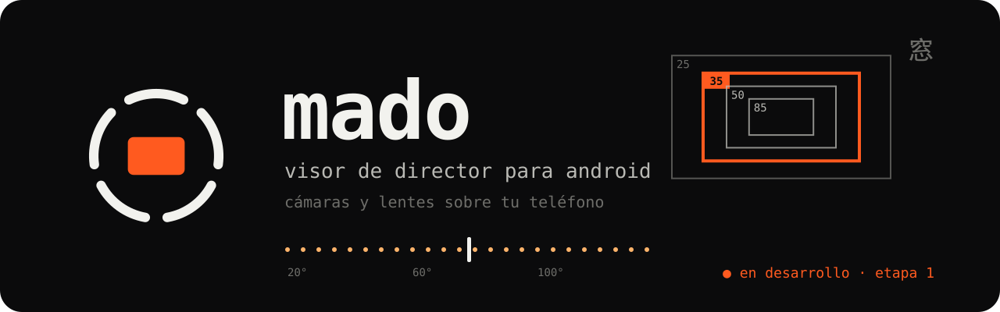
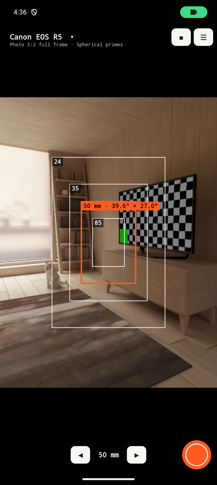
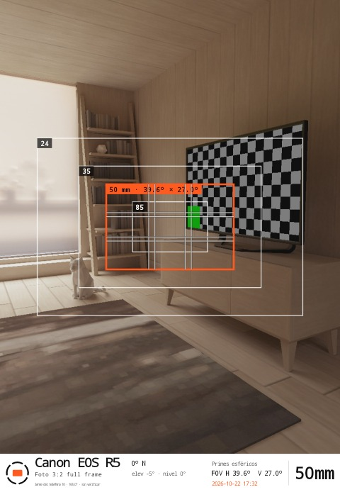
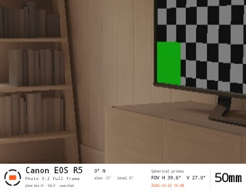
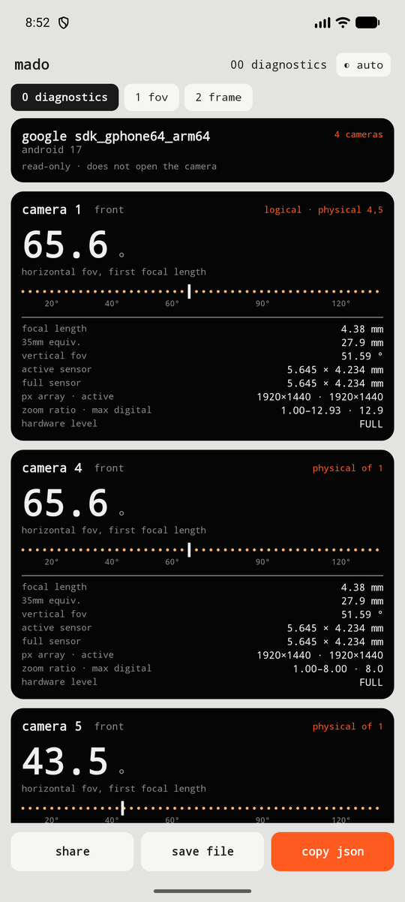
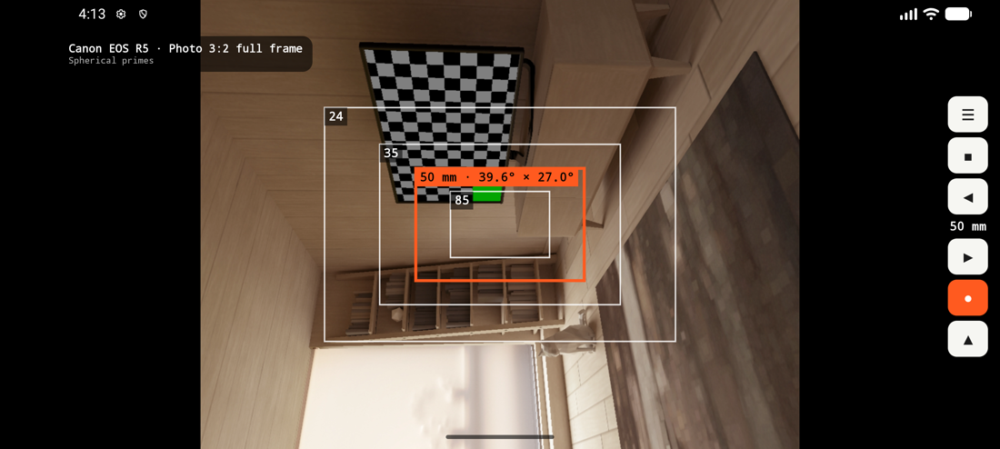
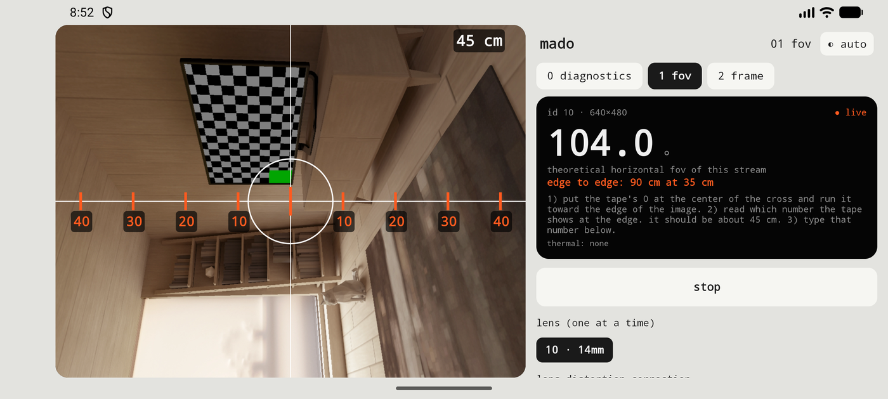

<p align="center">
  
</p>

<p align="center"><a href="README.md">Español</a> · <b>English</b> · 日本語: in the app</p>

# Mado 窓

**A director's viewfinder for Android.** It simulates cameras and lenses over your phone's camera so you can compose a frame while location scouting, without carrying gear. *Mado* (窓) means window.

Pick a camera, a recording mode and a focal length, and Mado draws on the viewfinder the frame that camera would see. If the camera's field is wider than the phone's, it shows the padding. Companion to [LUX-0](https://github.com/Ultramal13/lux-0), the light meter.

> **Status: in development, field tool.** It works and is being tested on a Galaxy S26 Ultra. Accuracy still needs validating on more lenses and phones. No release yet.
>
> UI in **Spanish, English and Japanese** (the Japanese review is pending).

---

## Screenshots

| Frame (portrait) | Photo with the kit frames | Cropped shot (storyboard) | Camera diagnostics |
|---|---|---|---|
|  |  |  |  |

| Frame (landscape, the viewfinder uses the full height) | FOV test with a theoretical ruler |
|---|---|
|  |  |

*Screenshots come from the Android emulator (virtual scene); the app also runs on a real phone.*

---

## What it does today

- **Viewfinder (start screen):** draws **all the focal lengths of your kit at once** over the viewfinder (for example 24, 35, 50 and 85), the current one in orange, without dimming the outside. Sensor, recording mode and anamorphic squeeze (it multiplies the aspect) come from the chosen camera. If the widest focal length's field exceeds the phone's, the phone image shrinks and that frame fills the viewfinder.
- **Full-screen viewfinder:** the image fills the full width (portrait) or full height (landscape). Top left, the chosen camera and mode: **tapping them opens the setup** (camera, mode, lenses, kit, location). Below, **◀ focal ▶** and the shutter. The camera uses a shape close to your screen's, so the image fills almost all of it. **Double-tapping the image** toggles the cropped view: the current frame fills the viewfinder, "as it would turn out", with camera, mode, focal length and FOV H/V on top. Frames are always horizontal, also with the phone held upright. **A single tap** focuses and meters at that point; the panel has an **exposure compensation (EV)**. A big button in the centre starts the camera; **■** stops it and **☰** opens the menu. Designed for small, low-resolution screens.
- **Composition guides** inside the current frame: rule of thirds, **golden ratio**, centre cross, grid and safe areas (chosen in the panel and remembered). The ☰ menu shows the app's logo, name and version.
- **One fixed phone lens at a time**, so Android never switches lenses by itself and throws off the maths.
- **Photo capture:** every shot saves **two full-resolution files**, with the data also in the EXIF: the photo **with the kit frames** (current focal length in orange, with its measure) and the **shot cropped exactly to the frame**, ready for a storyboard. Both carry a white bar with the logo; on the left the **camera name in large type**, the recording mode and the phone lens; in the centre the **compass** (heading, elevation and level) and, if you turn it on, the **location**; on the right the lens set, the **FOV H/V** field of view (horizontal and vertical), the date and the **focal length in large type**. Location is optional, asks for permission and is read once when you shoot.
- **Calibrate lenses** (☰ menu): measures each lens's real field against the calculated one and saves the readings.
- **Diagnostics** (☰ menu): lists the cameras Camera2 exposes (focal length, sensor, FOV) and exports a JSON saved to *Downloads/Mado*.
- **Calibrated profile per lens:** the S26 Ultra main lens was measured by hand (real FOV ≈ 71.8° vs 74.0° theoretical). A lens without a profile shows "precision not verified".
- **Thermal protection:** no continuous RAW or full-resolution capture; small preview stream; the camera shuts itself off when idle, when you leave the app, or when the phone heats up.
- **Light, dark and red-night themes**, in the same visual language as LUX-0.

---

## Cameras

Data lives in [`app/src/main/assets/camaras.json`](app/src/main/assets/camaras.json); **every mode carries its source**, and `derivado: true` flags values we calculated because the maker does not publish them.

| Camera | Data |
|---|---|
| Canon EOS R5 · **main** | official sensor; derived video modes |
| Insta360 Luna Ultra · **main** | official equivalent focal lengths only (20 and 60 mm) |
| Sony FX3 · **main** | official sensor; derived video |
| Sony A7 IV | official sensor; derived video |
| Sony Venice 2 (8K and 6K) | Sony's official table |
| ARRI Alexa Mini LF · Alexa 35 · Alexa Mini · Alexa (Classic and XT) | ARRI's official tech sheets |
| RED V-RAPTOR (VV and S35) · KOMODO · KOMODO-X | RED's official guides, format tables |
| Sony BURANO | "Sensor Modes" table on pro.sony |
| Sony FX6 | **estimated**: Sony publishes "35 mm full-frame, 10.2 MP" but not the mm; the FX3's width is used and flagged in the app |

Research with sources is in [`datos-camaras/`](datos-camaras/). There is also a custom camera (sensor + focal length) and spherical and anamorphic lens sets.

---

## Download

The latest test version is under **[Releases](https://github.com/Ultramal13/mado/releases/latest)**: download the `.apk` on an Android 10+ phone and open it (Android will ask you to allow unknown sources for the browser or file manager). To measure your lenses' field of view follow [`docs/medicion-fov.md`](docs/medicion-fov.md).

The app language is chosen from the **☰** menu → language: automatic, Spanish, English or Japanese.

## Build

Needs JDK 21, Gradle 9.8+ and the Android SDK (platform 37.2). There is no Gradle wrapper in the repo yet.

```
echo "sdk.dir=/path/to/sdk" > local.properties
gradle :app:assembleDebug
```

Minimum Android 10 (API 29).

## Roadmap

1. **Stage 0 (done):** Camera2 diagnostics and FOV accuracy test.
2. **Stage 1 (in progress):** camera, lens and aspect selection; frame with padding; custom camera; capture with metadata; camera catalog. Remote catalog download is still missing.
3. **Stage 2:** focal-length arrows with neighbouring frames at once, composition guides, favourite setups, gallery, projects and PDF shot lists.
4. **Stage 3:** field tests in Japan and a decision on commercialisation.

## More

- Decisions, rules and status: [`CLAUDE.md`](CLAUDE.md) (in Spanish)
- Reference ideas from other viewfinder apps: [`docs/ideas-visor-referencia.md`](docs/ideas-visor-referencia.md) (in Spanish)
- Icon and brand: [`docs/branding/`](docs/branding/) and [`tools/make_icon.py`](tools/make_icon.py)
