# Mado · Director's Viewfinder
## User manual

Version 0.2.40 beta · November 2026

---

## 1. What Mado is

Mado (窓, "window" in Japanese) turns your phone camera into a **director's viewfinder**. You pick a camera, a recording mode and a lens, and Mado draws over the live image the frame that camera would see. It is for composing shots on a *location scout* without carrying gear, and for writing down everything another person needs to repeat the shot with the real camera.

Mado does not record video: it takes **photos of the frame** and adds the technical data to them.

It also works for **photography**: it shows the frame of a stills camera and a focal length without carrying it, horizontal or vertical, with its depth of field (chapter 7), and where the **sun** will be at each hour (chapter 8).

> **Important.** The frame is a simulation. Its accuracy depends on the calibration of your phone's lens (see chapter 12). Where a lens is not calibrated, Mado says so.

## 2. Before you start

- **Phone:** Android 10 or later.
- **Permissions:** camera (required) and location (optional, to record the place and the heading and to work out the sun's position). Mado has **no internet permission**: nothing leaves your phone.
- **Calibrated phones in this version:** Samsung Galaxy S26 Ultra (main lens and both telephoto lenses; the ultra-wide is still to be measured) and Sony Xperia 1 III (SO-51B, all three rear lenses). On any other phone Mado uses the data the phone reports and tells you so.
- **Installing the beta:** you receive the APK file from whoever invited you. Open it and allow installing from unknown sources. Install it over the previous version, without uninstalling.

## 3. First steps (5 minutes)

1. Open Mado. It starts on the **Canon EOS R5**.
2. Tap **start preview** (the orange button in the middle).
3. Look at the frames drawn over the image: the **orange** one is the current focal length and the **white** ones are the rest of your focal kit.
4. Change focal length with the **◄ ►** arrows at the bottom.
5. Tap the **shutter** (the orange circle). The photo is saved in `Pictures/Mado`.

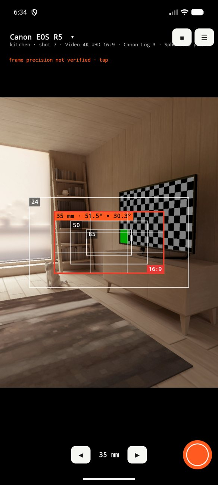

## 4. The viewfinder screen

- **Top left, the camera.** It shows the camera name and below it the scene and shot number, the recording mode, the colour profile and the lens set. **Tap it to open the options panel.**
- **Top right:** the **orientation** key switches the frame between horizontal and vertical, **☀** turns the sun on or off (chapter 8), **■** stops the preview and **☰** opens the menu. With the sun on, **◎** also appears, to adjust the compass.
- **The frames:** each one is a focal length of your kit; the orange one is the current one. If the camera you simulate sees **wider** than your phone, the frame fills the viewfinder and the phone image shrinks (you will see the padding).
- **Bottom:** ◄ focal length ► and the **shutter**. With the phone in landscape the keys move to the side.
- **Tapping the image** focuses and meters exposure at that point. A marker shows the distance the phone focused at (for example "1.33 m"). The focus stays locked until your next tap. With depth of field turned on, the marker adds the aperture and the sharp range (chapter 7).
- **Double tap:** cropped view, which shows the image **as it would come out** in the current frame. Tap the orange notice to go back.
- **The notice "frame precision not verified · tap"** appears when the phone lens is not calibrated (chapter 12).

## 5. Choosing camera, mode and lens (options panel)

Tap the camera name, top left. The panel scrolls up and down.

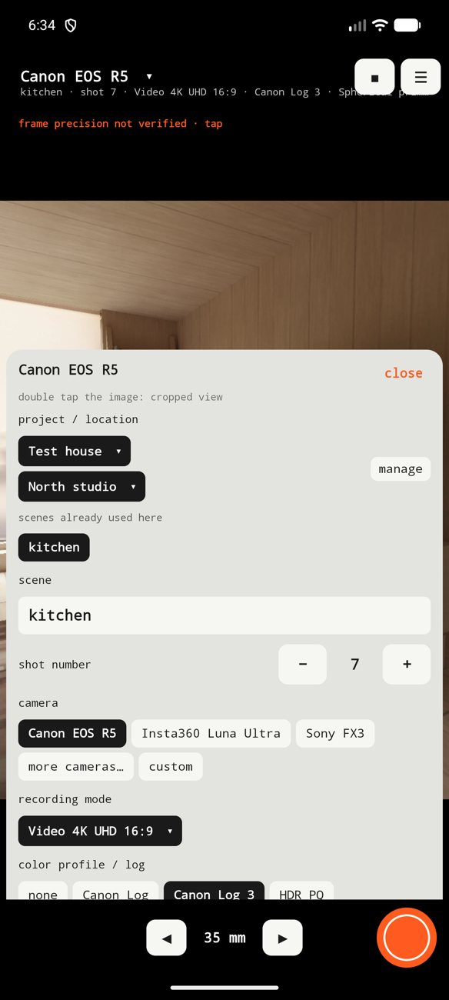 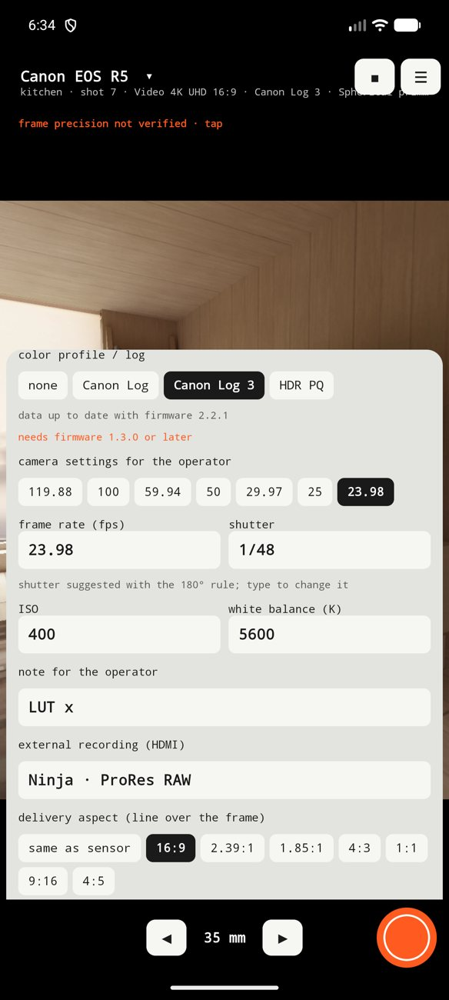

### 5.1 Camera
The three main cameras (**Canon EOS R5**, **Insta360 Luna Ultra** and **Sony FX3**) are in sight; the rest are under **more cameras…**, in alphabetical order: cinema cameras (ARRI, RED, Sony) and stills cameras from Sony, Canon, Nikon, Fujifilm, OM System and Panasonic, from Micro Four Thirds to medium format. With **custom** you type the sensor width and height in millimetres.

### 5.2 Recording mode
The field of view depends on the **sensor area each mode uses**, not only on the camera: recording 4K across the full sensor width is not the same as with a crop. Each camera comes with its modes and the official source. Where the maker does not publish the exact area, Mado marks it as **derived** (calculated by us). The information follows the newest firmware version we know of, and the panel says, for example, "data up to date with firmware 2.2.1". If a format needs a minimum firmware, it tells you.

### 5.3 Colour profile / log and Picture Profile
Choose the profile you will record (Canon Log, Canon Log 3, S-Log3, I-Log, HDR PQ…). It appears next to the mode, in the viewfinder and in the photo bar. On the **Sony FX3** you can also pick the **Picture Profile** (PP1 to PP6, PP10 and PP11); what each PP contains is set by whoever operates the camera, so describe it in the note (chapter 6).

### 5.4 Lens set and focal kit
- **Lens set:** pick one from the list. There are generic ones (spherical, anamorphic 2x and 1.33x, and two example zooms, 24-70 and 70-200 mm), four **Canon RF L** lenses (15-35 F2.8, 24-105 F4, 70-200 F2.8 and 50 F1.2) and sets with a **real name**: **DZOFilm Arles**, **Zeiss CP.3**, **Cooke S4/i** and **Atlas Orion 2x**, each with the source of its focal lengths. With anamorphic, the frame widens by the squeeze factor.
- **Your own sets:** with **new lens set** you type the name, the focal lengths separated by commas and, if it is anamorphic, its squeeze. They appear at the end of the list with ★ and are corrected or deleted with **edit this set**.
- When you choose a set, the drawn kit becomes the focal lengths closest to 24, 35, 50 and 85 mm. The focal lists of the named sets come from retailer listings and press, not always from the maker: check the set you carry and, if it differs, create your own.

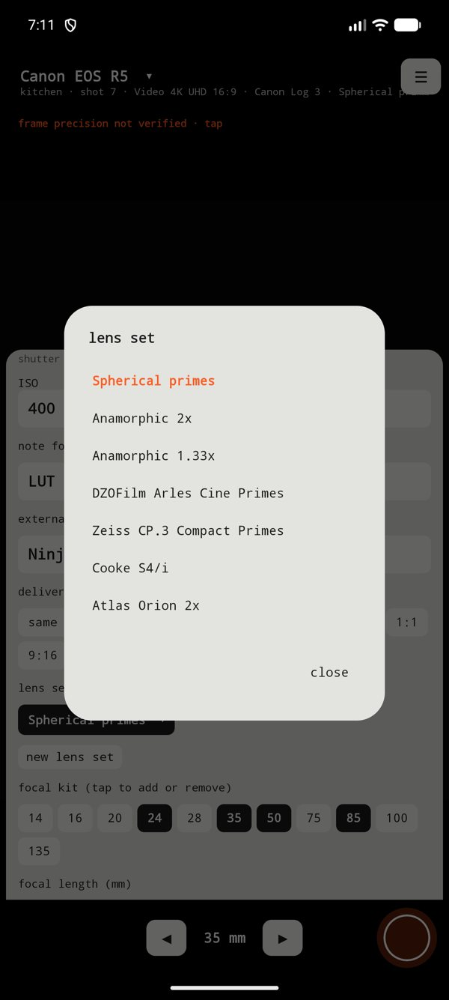 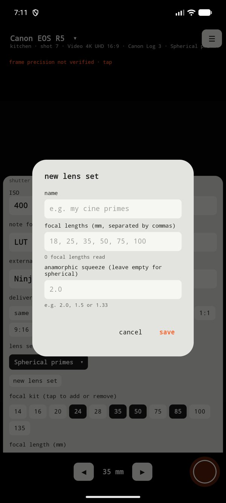
- **Focal kit:** tap the numbers to add or remove focal lengths; all of them are drawn at once.
- **Focal length (mm):** the current focal length. On fixed-lens cameras (such as the Luna Ultra) you choose the built-in lens and the focal length is the equivalent.

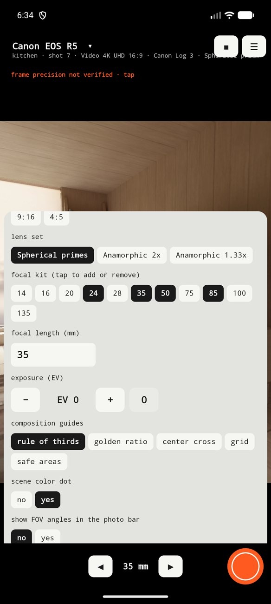 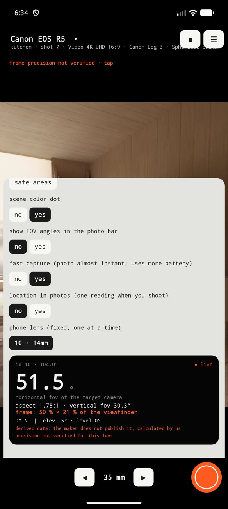

### 5.5 Delivery aspect
Draws a **red line** with the final delivery format (16:9, 2.39:1, 1.85:1, 4:3, 1:1, 9:16 or 4:5) over the sensor. For example, 16:9 over a 3:2 sensor.

### 5.6 Exposure, guides and other settings
- **Exposure (EV):** compensates the phone's exposure. It applies to the preview and the photo.
- **Composition guides:** rule of thirds, golden ratio, centre cross, grid and safe areas.
- **Scene colour dot:** a different colour dot for each scene on the photo's tag (can be turned off).
- **Show FOV angles in the photo bar:** off by default.
- **Fast capture:** the photo is taken almost instantly (uses more battery).
- **Location in photos:** one GPS reading when you shoot.
- **Phone lens:** the phone lens used as the base. Mado starts from the calibrated lens.
- **Frame orientation, depth of field and sun:** they have their own chapters (7 and 8).

## 6. Settings for the operator

The person doing the scout is not always the one operating the camera. This section stores what the operator needs:

- **Frame rate (fps):** pick one of those the mode offers, or type it.
- **Shutter:** suggested automatically with the **180° rule** (1/48 for 24 fps, 1/60 for 30 fps, 1/50 for 25 fps). Type another value and yours stays.
- **ISO** and **white balance (K).**
- **Picture Profile** (on the FX3).
- **Note for the operator:** for example the LUT or the ND filter.
- **External recording (HDMI):** the recorder and the format, for example "Ninja · ProRes RAW".

Everything shows in the photo bar and is saved separately in its data.

## 7. Photography: vertical frame, depth of field and focus

Mado is not only for video. The stills cameras in the catalogue carry their **photo modes** (3:2, 4:3, 16:9, 1:1 and the crops each one offers), and these three functions are made for photographers.

### 7.1 Vertical frame
In the panel, **frame orientation** has two options: **horizontal** and **vertical**. You can also switch it with the orientation key in the viewfinder. In vertical the frame turns 90°, as if you turned the camera, and the delivery-aspect line turns with it. The orientation is written in the photo's data.

### 7.2 Depth of field and hyperfocal
In the panel, turn on **depth of field and hyperfocal**.

1. Choose the **aperture** (f/1.4 to f/22).
2. Choose the **focus distance**: **the phone's focus** (tap the subject on the image) or **type it** in metres.
3. Mado shows two lines: "sharp from 0.87 m to 1.2 m (focused at 1.0 m)" and the **hyperfocal**, for example "hyperfocal 15 m: focus there and everything from 7.6 m to ∞ is sharp".

With the function on, tapping the image to focus makes the marker add the aperture and the sharp range, and saved photos carry a badge with the same data ("f/8 · focused at 1.0 m · sharp 0.87–1.2 m").

> **It is an approximate value.** The calculation uses the focal length, the aperture and the sensor size of the camera you are simulating, with a circle of confusion equal to the sensor diagonal divided by 1500. The phone photo does **not** show that blur: the phone has a different sensor and lens. It is not available for fixed-lens cameras that do not publish their sensor size.

### 7.3 Focus point on the photo
With the option **focus point on the photo** turned on, if you tapped to focus the saved photo carries a mark (brackets, a dot and the distance) where you tapped. The colour says what the phone reported: **green**, focus confirmed; **red**, it could not focus; **yellow**, not confirmed.

## 8. The sun

Mado works out where the sun is at any time of day and draws it over your frame: use it to know at what time the sun enters the shot, or where it will rise.

### 8.1 Turning it on
Tap **☀** in the viewfinder, or turn on **sun: position and key times** in the panel. It needs to know where you are: **use my location** (one GPS reading) or **type coordinates**. Date and time start at **today** and **now**, and can be changed to prepare another day.

### 8.2 What you see in the viewfinder
- **A circle** where the sun is. If it is outside the image, an arrow shows which way to turn and how many degrees away it is, with "behind you" or "below the horizon" when that applies.
- **The day's path**, a line with hour marks ("11h", "12h"…).
- **The timeline**, at the bottom: slide it to move the hour and watch the sun travel. The **now** key returns to the current time.
- **A label** with the hours when the sun is inside the current frame ("sun in this frame: 11:01–13:38") or the notice that it does not cross it that day. It changes with the camera, the focal length and where you point.

In the panel you can also draw the **solstice and equinox** paths, to see how it changes through the year.

### 8.3 Key times
The panel lists, in the phone's clock time: sunrise, sunset, solar noon, morning and evening golden hour and blue hour, plus the sun's azimuth and elevation.

### 8.4 Adjusting the compass with the real sun
The sun calculation is exact; what fails is the **phone compass**, which in our tests was off by 15° to 22°, and more near metal or magnets. To correct it:

1. With the sun in view and the time set to **now**, tap **◎** in the viewfinder.
2. Tap **the real sun on the image** (use the screen, do not look at the sun directly).
3. Mado stores the adjustment and shows it in the panel. **Remove calibration** returns to the compass value.

If "compass unreliable" appears, move the phone in a figure 8. ◎ needs the sun well above the horizon.

**If you see "compass ±15° (steel nearby)"**, the magnetic field here is not normal (steel, parked cars, reinforced concrete): the heading can be 10–15° off and no calibration fixes it. For that shot use **◎** on the real sun, or move away from the structures.

**If the compass stays off, or the "compass disturbed" notice does not go away**, the phone itself may carry a magnet or iron (case, ring, mount) that bends the sensor, and the error changes with how you hold it (horizontal or vertical). That is what **calibrate the compass by rotating the phone** is for, in the sun panel:

1. Set your location (**use my location**), away from cables, magnets and metal.
2. Tap **start** and turn the phone slowly in every direction for about 15 seconds: flat, upright, on its side and upside down. A percentage shows on screen.
3. At 100 % Mado says "compass calibrated" and from then on works out the heading from the field with the phone's own offset removed. It lasts 24 hours; **remove calibration** goes back to the factory sensor.

If you change the case, mount or cable, calibrate again. Calibrate in an open place if you can: near buildings or cars the field is no longer the Earth's and the adjustment comes out worse.

### 8.5 In the photos, and privacy
With the sun on, saved photos carry the circle, the path and the hours label, and their data record the sun's position. The location is used only inside the phone for this calculation.

## 9. The photo: what Mado saves

Every time you tap the shutter, **two images** are saved in `Pictures/Mado`:

- **`_marco`:** the photo with the frames of the whole kit, the guides and the delivery line.
- **`_plano`:** the photo cropped exactly to the current frame, as it would come out.

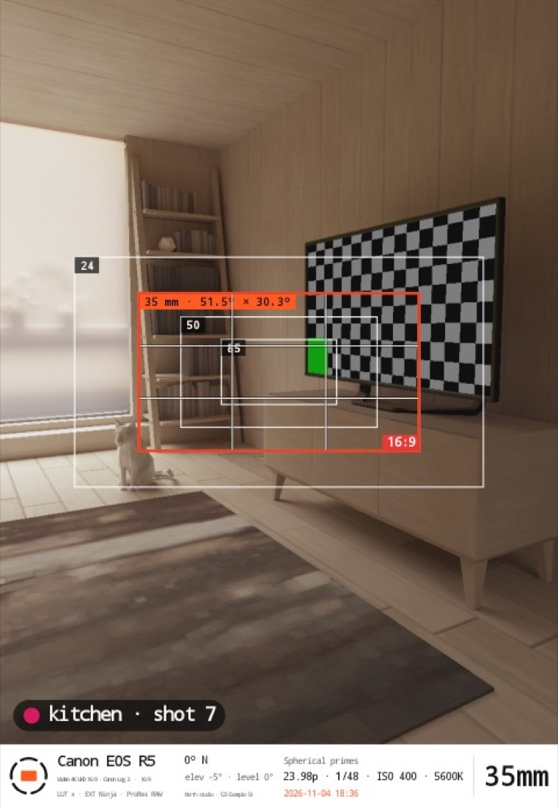

The **bottom bar** carries: camera and mode (with the colour profile), the phone lens or your note, the heading and tilt, the location name (if a project is selected) or the coordinates, the lens set or the operator settings, the date and time, and the **focal length in large type**. The **scene tag** ("kitchen · shot 7") sits at the bottom left of the image.

If you moved the phone while the photo was being taken, a notice tells you: the photo may come out shifted.

With the sun on, both images also carry the sun circle, its path and the hours when it enters the frame (chapter 8). With depth of field on, they carry the aperture, the focus distance and the sharp range; and if you tapped to focus, the focus-point mark (chapter 7).

## 10. Projects, locations and scenes

Menu **☰ → projects and locations**.

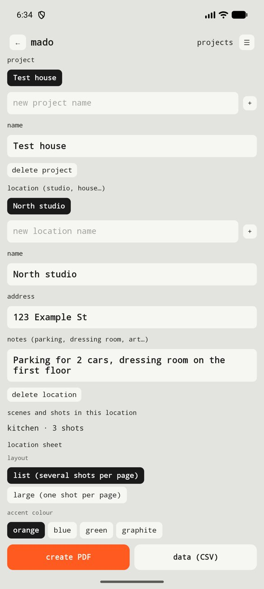

1. **Project:** type the name and tap **+**.
2. **Location** (a studio, a house…): type the name and tap **+**. Write the **address** and the **logistics notes** (parking, dressing room, art department…).
3. In the options panel you choose the active project and location. Every photo is tied to them.
4. The **scene** (for example "fireplace") and the **shot number** are typed in the panel. After each photo the number goes up by itself. Scenes already used in the location appear as shortcuts and continue their numbering.

5. **View and edit the shots:** on the same screen, tap **view and edit shots**. You will see each shot with its thumbnail, grouped by scene. Tap one to correct its **scene**, **shot number** and **operator settings**, to **open the photo** or to **delete it**. The photo keeps the label it was taken with; the location sheet and the CSV use the corrected data. When deleting, you choose between removing it only from the sheet (the photos stay in the gallery) or deleting its photos too (this cannot be undone).

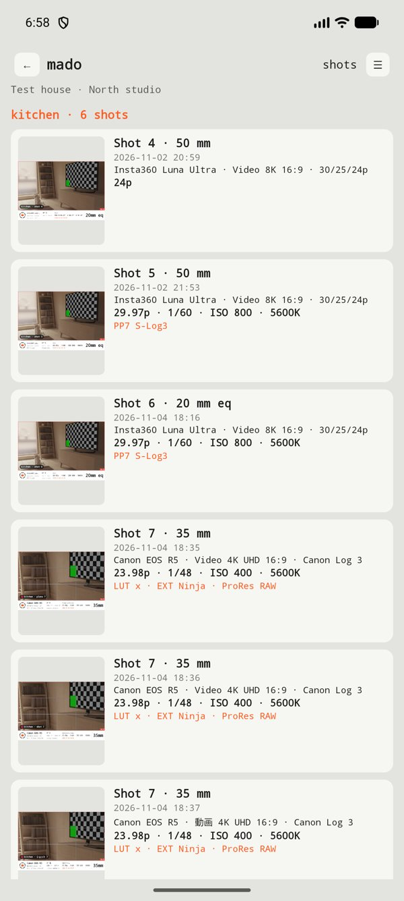 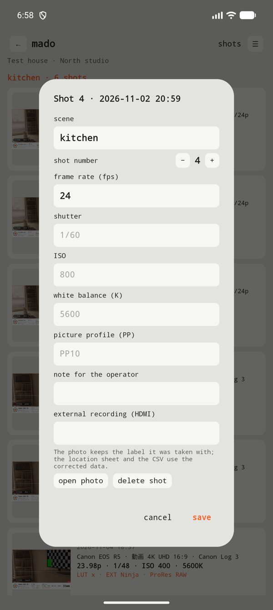

Deleting a project or a location only removes it from the list: **the photos stay in the gallery.**

## 11. Location sheet (PDF and CSV)

On the projects screen, below the scenes, there is the **location sheet** section.

1. Choose the **layout:** *list* (several shots per page) or *large* (one shot per page, with the full frame view).
2. Choose the **accent colour** (orange, blue, green or graphite).
3. Tap **create PDF**. It is saved in `Downloads/Mado` and the share menu opens.

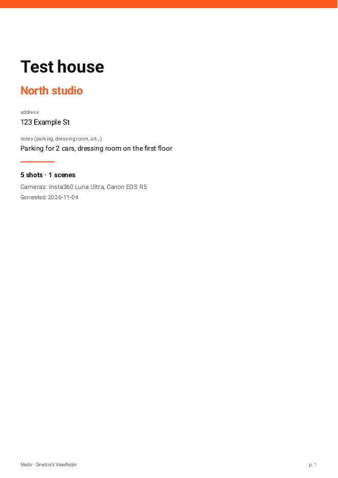 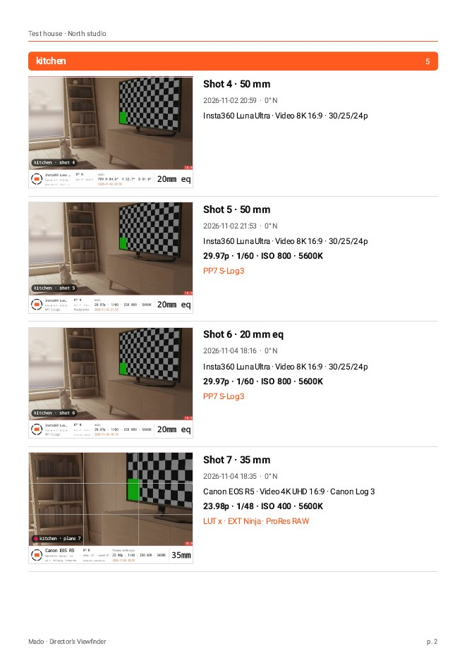 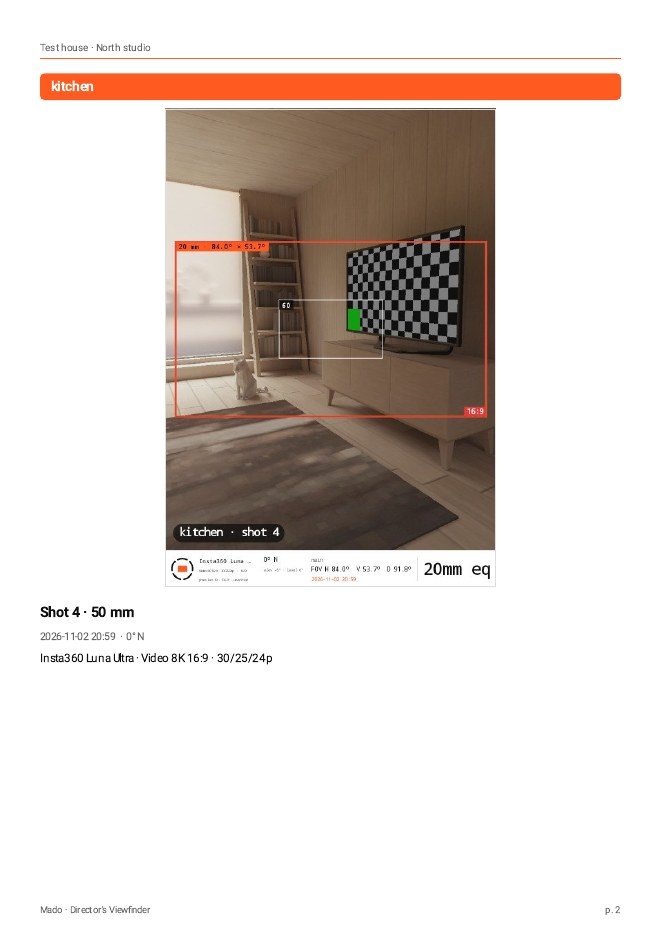

The PDF is A4 on a white background. The cover carries the project, the location, the address, the notes, the totals and the cameras used. Shots are grouped by scene, with their photo, shot number, focal length, time, heading, camera and mode, the operator settings and the notes. It includes Japanese text. If a photo was deleted from the gallery, the sheet says so in its place.

**Data (CSV):** one row per shot, for those who prefer to build the document in Keynote, Canva or a spreadsheet.

## 12. Calibration: why it matters and how to do it

The frame is calculated from the **field of view of the phone lens**. Each phone reports that figure with an error of a few degrees, larger on wide-angle lenses. When a lens is **calibrated** (measured), the frame is accurate. When it is not, the notice appears and the photo records it as "not verified".

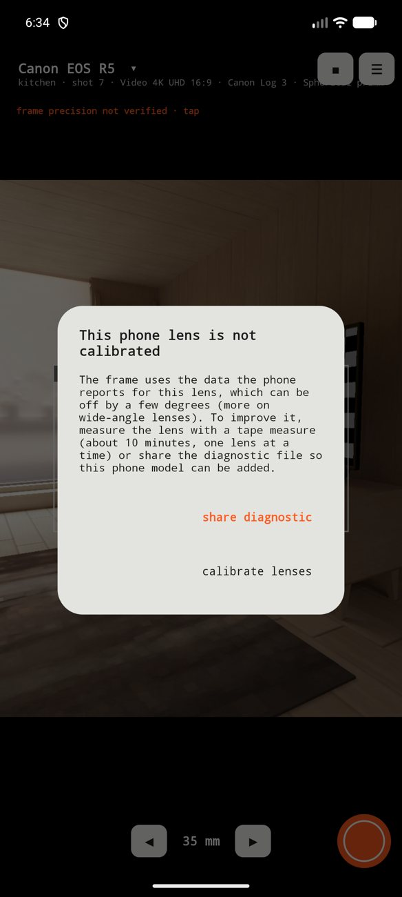

**If your phone is not calibrated, you have two options** from the notice:

- **Share diagnostic:** sends the phone's technical file (model, Android version and data about its cameras, no photos or location) so we can add your model.
- **Calibrate lenses:** you measure the lens yourself (about 10 minutes per lens).

### How to measure a lens
You need a **tape measure**, adhesive tape and a flat wall. Menu **☰ → calibrate lenses**.

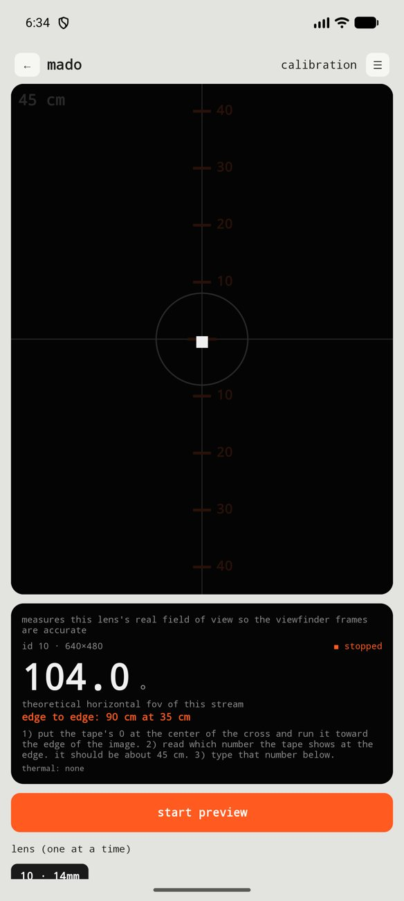

1. Choose the **lens**, one at a time. The app suggests the **distance** to the wall.
2. Stick the tape on the wall horizontally, at the height of the lens. Place the phone (in landscape) at that distance, **measured from the lens glass**, pointing straight at it and resting on something steady.
3. Tap **start preview**. Put the tape's **0 under the cross** in the centre and run it toward one edge of the image.
4. Read **which tape number sits right at the image edge** and type it. Tap **save**.
5. Tap **stop** before switching lens and repeat with each one.
6. When you finish, tap **share** to send the readings.

> **Tips.** The orange numbers on the screen are a guide ruler calculated with the theoretical value: the number that matters is the one at the edge. A distance error weighs a lot on wide-angle lenses; measure twice. Telephoto lenses may not focus up close: use 1 m or more. If the phone gets warm, stop.

The screen also shows the phone's **internal calibration** (if it provides one), so you can compare it with what you read on the tape.

## 13. Heat, battery and privacy

- **To avoid heating the phone,** the preview is light and has limits: it pauses after **90 seconds without touching the screen**, stops after **5 minutes** and switches off if the phone gets **hot** (you will see a notice). Resume with **start preview**.
- **The full-resolution photo** is only taken when you tap the shutter.
- **Privacy:** no ads, no tracking and no internet permission. Photos, projects and settings stay on your phone. The diagnostic file is only shared if you send it. The full policy is in `docs/politica-privacidad.md`.

## 14. Language and theme

Menu **☰ → language** (automatic, español, English or 日本語) and **☰ → theme** (automatic, light, dark or **red** for dark sets).

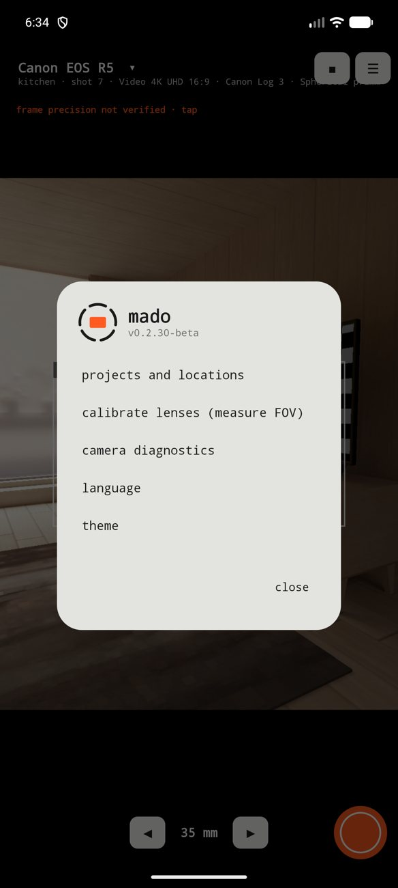

## 15. Troubleshooting

- **The frame does not match what I see.** Calibrate the lens (chapter 12). Without calibration the error can be a few degrees.
- **The background comes out blurred.** Tap the subject you want in focus on the screen and read the distance that appears next to the marker. The focus stays locked until your next tap. To go back to continuous focus, restart the preview.
- **The sun circle does not land on the real sun.** It is the phone compass, not the calculation. Move the phone in a figure 8 and use **◎** to adjust it by tapping the real sun (chapter 8).
- **The photo says "focused" but looks blurry.** The depth of field Mado shows is that of the simulated camera, not the phone's. Also, the phone autofocus can accept a sky or a plain wall with no detail: tap an object with clear edges.
- **"The phone moved" notice.** Keep the phone still until "✓ saved" appears.
- **The camera switched off by itself.** It was inactivity (90 s), the 5-minute limit or heat.
- **A photo says "photo not available" in the PDF.** The original photo is no longer in the gallery.
- **I need a format that is not there.** Use "custom" and type the sensor, and tell us which camera and mode you are missing.

## 16. Glossary

- **FOV (field of view):** how much a lens covers, in degrees.
- **Delivery aspect:** the final aspect ratio of the video (for example 16:9).
- **Squeeze factor:** how much an anamorphic lens compresses the image horizontally (2x, 1.33x).
- **Log:** a flat recording curve that leaves more room when grading colour (S-Log3, Canon Log 3, I-Log…).
- **Picture Profile (PP):** an image setting stored in Sony cameras.
- **180° rule:** shutter speed equal to half the time of each frame (1/48 s at 24 fps).
- **Depth of field:** the zone in front of and behind the focus point that looks sharp.
- **Hyperfocal:** the focus distance that keeps everything sharp from half that distance to infinity.
- **Azimuth and elevation:** the sun's compass direction (0° = north) and its height above the horizon, in degrees.
- **Golden hour and blue hour:** the low, warm light near sunrise and sunset, and the bluish light just before and after.
- **Full-frame equivalent:** the focal length that would give the same field on a 36 mm wide sensor.

## 17. Feedback

Mado is in beta and your experience improves the app. Tell us which cameras you use, what data you need to see and what fails. Write to whoever invited you to the beta. *(Contact email: to be defined before launch.)*
