# Mado · Director's Viewfinder
## Manual de uso

Versión 0.2.40 beta · noviembre de 2026

---

## 1. Qué es Mado

Mado (窓, «ventana» en japonés) convierte la cámara de tu teléfono en un **visor de director**. Eliges una cámara, un modo de grabación y un lente, y Mado dibuja sobre la imagen en vivo el recuadro que esa cámara vería. Sirve para componer planos durante un *location scout* sin cargar equipo, y para dejar anotado todo lo que otra persona necesita para repetir el plano con la cámara real.

Mado no graba video: toma **fotos del encuadre** y les agrega los datos técnicos.

También sirve para **fotografía**: muestra el encuadre de una cámara de fotos y una focal sin llevarla, en horizontal o en vertical, con su profundidad de campo (capítulo 7), y dónde estará el **sol** a cada hora (capítulo 8).

> **Importante.** El recuadro es una simulación. Su precisión depende de la calibración del lente de tu teléfono (ver el capítulo 12). Donde un lente no está calibrado, Mado lo avisa.

## 2. Antes de empezar

- **Teléfono:** Android 10 o superior.
- **Permisos:** cámara (necesario) y ubicación (opcional, para registrar el lugar y el rumbo y para calcular la posición del sol). Mado **no tiene permiso de internet**: nada sale de tu teléfono.
- **Teléfonos calibrados en esta versión:** Samsung Galaxy S26 Ultra (lente principal y los dos teleobjetivos; el ultra gran angular está por medir) y Sony Xperia 1 III (SO-51B, las tres lentes traseras). En cualquier otro teléfono, Mado usa los datos que el teléfono informa y lo avisa.
- **Instalación de la beta:** recibes el archivo APK de quien te invitó. Ábrelo y permite instalar de orígenes desconocidos. Instálalo encima de la versión anterior, sin desinstalar.

## 3. Primeros pasos (5 minutos)

1. Abre Mado. Arranca en la **Canon EOS R5**.
2. Toca **iniciar preview** (el botón naranja en el centro).
3. Mira los recuadros que aparecen sobre la imagen: el **naranja** es la focal actual y los **blancos** son el resto de tu kit de focales.
4. Cambia de focal con las flechas **◄ ►** de abajo.
5. Toca el **obturador** (el círculo naranja). La foto queda guardada en `Pictures/Mado`.

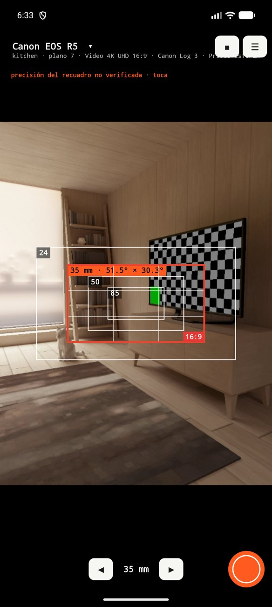

## 4. La pantalla del visor

- **Arriba a la izquierda, la cámara.** Muestra el nombre de la cámara y debajo la escena y el número de plano, el modo de grabación, el perfil de color y el juego de lentes. **Tócala para abrir el panel de opciones.**
- **Arriba a la derecha:** la tecla de **orientación** cambia el encuadre entre horizontal y vertical, **☀** enciende o apaga el sol (capítulo 8), **■** detiene el preview y **☰** abre el menú. Con el sol encendido aparece también **◎**, para ajustar la brújula.
- **Los recuadros:** cada uno es una focal de tu kit; el naranja es la actual. Si la cámara que simulas ve **más ancho** que tu teléfono, el recuadro llena el visor y la imagen del teléfono se achica (verás el relleno).
- **Abajo:** ◄ focal ► y el **obturador**. Con el teléfono en horizontal, las teclas pasan al costado.
- **Tocar la imagen** enfoca y mide la exposición en ese punto. Aparece un marcador con la distancia a la que enfocó el teléfono (por ejemplo «1.33 m»). El foco queda fijo hasta tu siguiente toque. Con la profundidad de campo activada, el marcador agrega la apertura y el rango nítido (capítulo 7).
- **Doble toque:** vista recortada, que muestra la imagen **tal como saldría** en el encuadre actual. Vuelves tocando el aviso naranja.
- **El aviso «precisión del recuadro no verificada · toca»** aparece cuando el lente del teléfono no está calibrado (capítulo 12).

## 5. Elegir cámara, modo y lente (panel de opciones)

Toca el nombre de la cámara, arriba a la izquierda. El panel se desplaza hacia arriba y abajo.

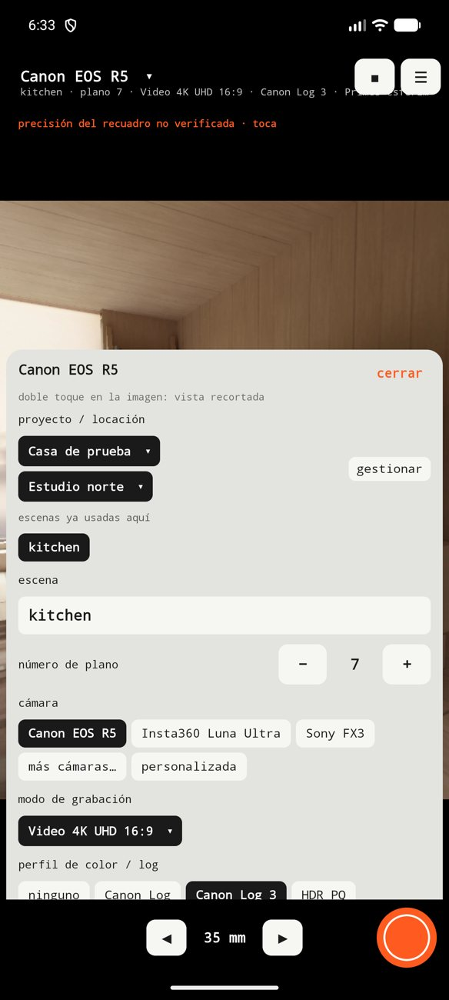 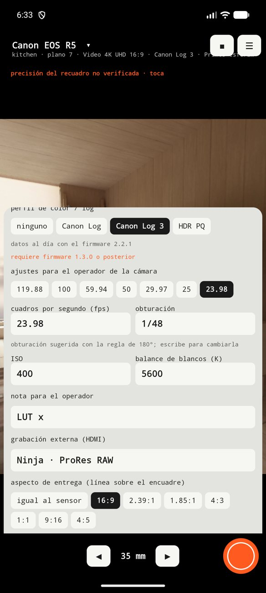

### 5.1 Cámara
Las tres cámaras principales (**Canon EOS R5**, **Insta360 Luna Ultra** y **Sony FX3**) están a la vista; el resto está en **más cámaras…**, por orden alfabético: cámaras de cine (ARRI, RED, Sony) y cámaras de foto de Sony, Canon, Nikon, Fujifilm, OM System y Panasonic, desde Micro Cuatro Tercios hasta formato medio. Con **personalizada** escribes el ancho y alto del sensor en milímetros.

### 5.2 Modo de grabación
El campo de visión depende del **área del sensor que usa cada modo**, no solo de la cámara: no es lo mismo grabar 4K en todo el ancho del sensor que con recorte. Cada cámara trae sus modos con la fuente oficial. Donde el fabricante no publica el área exacta, Mado lo marca como dato **derivado** (calculado por nosotros). La información sigue la versión de firmware más nueva conocida y el panel dice, por ejemplo, «datos al día con el firmware 2.2.1». Si un formato exige un firmware mínimo, lo avisa.

### 5.3 Perfil de color / log y Picture Profile
Elige el perfil que vas a grabar (Canon Log, Canon Log 3, S-Log3, I-Log, HDR PQ…). Aparece junto al modo, en el visor y en la barra de la foto. En la **Sony FX3** también puedes elegir el **Picture Profile** (PP1 a PP6, PP10 y PP11); lo que contiene cada PP lo configura quien opera la cámara, así que descríbelo en la nota (capítulo 6).

### 5.4 Juego de lentes y kit de focales
- **Juego de lentes:** elige uno de la lista. Hay genéricos (esféricos, anamórficos 2x y 1.33x, y dos zooms de ejemplo, 24-70 y 70-200 mm), cuatro lentes **Canon RF L** (15-35 F2.8, 24-105 F4, 70-200 F2.8 y 50 F1.2) y juegos con **nombre real**: **DZOFilm Arles**, **Zeiss CP.3**, **Cooke S4/i** y **Atlas Orion 2x**, cada uno con la fuente de sus focales. En anamórfico, el recuadro se ensancha según el factor de compresión.
- **Tus propios juegos:** con **juego nuevo** escribes el nombre, las focales separadas por comas y, si es anamórfico, su compresión. Aparecen al final de la lista con ★ y se corrigen o borran con **editar este juego**.
- Al elegir un juego, el kit dibujado pasa a las focales más cercanas a 24, 35, 50 y 85 mm. Las listas de focales de los juegos con nombre salen de fichas de tiendas y de la prensa, no siempre del fabricante: confirma el set que llevas y, si difiere, crea el tuyo.

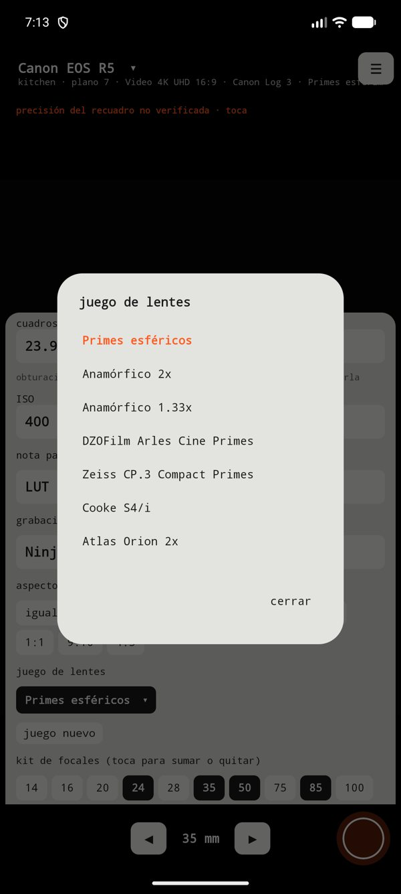 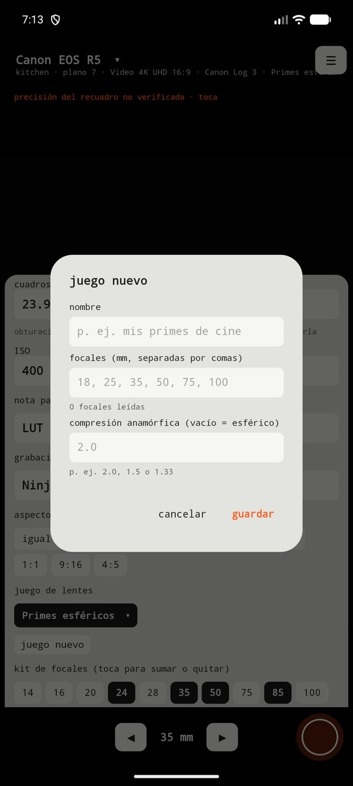
- **Kit de focales:** toca los números para sumar o quitar focales; todas se dibujan a la vez.
- **Focal (mm):** la focal actual. En cámaras de lente fijo (como la Luna Ultra) eliges el lente integrado y la focal es la equivalente.

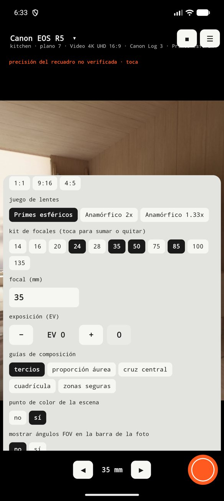 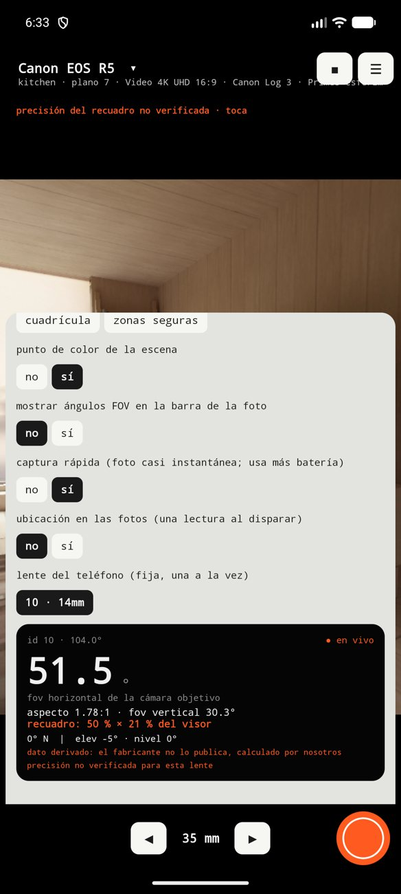

### 5.5 Aspecto de entrega
Dibuja una **línea roja** con el formato final de entrega (16:9, 2.39:1, 1.85:1, 4:3, 1:1, 9:16 o 4:5) sobre el sensor. Por ejemplo, 16:9 sobre un sensor 3:2.

### 5.6 Exposición, guías y otros ajustes
- **Exposición (EV):** compensa la exposición del teléfono. Vale para el preview y la foto.
- **Guías de composición:** tercios, proporción áurea, cruz central, cuadrícula y zonas seguras.
- **Punto de color de la escena:** un punto de color distinto por escena en la etiqueta de la foto (se puede apagar).
- **Mostrar ángulos FOV en la barra:** apagado por defecto.
- **Captura rápida:** la foto sale casi al instante (usa más batería).
- **Ubicación en las fotos:** una lectura del GPS al disparar.
- **Lente del teléfono:** el lente del teléfono que se usa de base. Mado parte del lente calibrado.
- **Orientación del encuadre, profundidad de campo y sol:** tienen sus propios capítulos (7 y 8).

## 6. Ajustes para el operador

Quien hace el scout no siempre es quien opera la cámara. Esta sección guarda lo que el operador necesita:

- **Cuadros por segundo (fps):** eliges uno de los que ofrece el modo, o lo escribes.
- **Obturación:** se propone sola con la **regla de 180°** (1/48 para 24 fps, 1/60 para 30 fps, 1/50 para 25 fps). Escribe otro valor y queda el tuyo.
- **ISO** y **balance de blancos (K).**
- **Picture Profile** (en la FX3).
- **Nota para el operador:** por ejemplo la LUT o el filtro ND.
- **Grabación externa (HDMI):** el grabador y el formato, por ejemplo «Ninja · ProRes RAW».

Todo sale en la barra de la foto y se guarda por separado en sus datos.

## 7. Fotografía: encuadre vertical, profundidad de campo y enfoque

Mado no es solo para video. Las cámaras de fotos del catálogo traen sus **modos de foto** (3:2, 4:3, 16:9, 1:1 y los recortes que ofrece cada una), y estas tres funciones están pensadas para quien fotografía.

### 7.1 Encuadre vertical
En el panel, **orientación del encuadre** tiene dos opciones: **horizontal** y **vertical**. También se cambia con la tecla de orientación del visor. En vertical el recuadro gira 90°, como si giraras la cámara, y la línea del aspecto de entrega gira con él. La orientación queda anotada en los datos de la foto.

### 7.2 Profundidad de campo e hiperfocal
En el panel, activa **profundidad de campo e hiperfocal**.

1. Elige la **apertura** (de f/1.4 a f/22).
2. Elige la **distancia de enfoque**: **la que enfoca el teléfono** (toca el sujeto en la imagen) o **escribirla** en metros.
3. Mado muestra dos líneas: «nítido de 0.87 m a 1.2 m (enfocado a 1.0 m)» y la **hiperfocal**, por ejemplo «hiperfocal 15 m: enfoca ahí y todo desde 7.6 m hasta el infinito queda nítido».

Con la función activada, al tocar la imagen para enfocar el marcador agrega la apertura y el rango nítido, y las fotos guardadas llevan una insignia con los mismos datos («f/8 · enfocado a 1.0 m · nítido 0.87–1.2 m»).

> **Es un valor aproximado.** El cálculo usa la focal, la apertura y el tamaño del sensor de la cámara que simulas, con un círculo de confusión igual a la diagonal del sensor dividida por 1500. La foto del teléfono **no** muestra ese desenfoque: el teléfono tiene otro sensor y otro lente. No está disponible en cámaras de lente fijo que no publican el tamaño del sensor.

### 7.3 Punto de enfoque en la foto
Con la opción **punto de enfoque en la foto** activada, si tocaste para enfocar la foto guardada lleva una marca (corchetes, un punto y la distancia) en el lugar que tocaste. El color dice qué informó el teléfono: **verde**, enfoque confirmado; **rojo**, no logró enfocar; **amarillo**, sin confirmar.

## 8. El sol

Mado calcula dónde está el sol a cualquier hora del día y lo dibuja sobre tu encuadre: sirve para saber a qué hora entra el sol al plano, o por dónde saldrá.

### 8.1 Encenderlo
Toca **☀** en el visor, o activa **sol: posición y horas clave** en el panel. Necesita saber dónde estás: **usar mi ubicación** (una lectura del GPS) o **escribir coordenadas**. La fecha y la hora parten en **hoy** y **ahora**, y se pueden cambiar para preparar otro día.

### 8.2 Qué se ve en el visor
- **Un círculo** donde está el sol. Si queda fuera de la imagen, una flecha indica hacia dónde girar y a cuántos grados está, con «a tu espalda» o «bajo el horizonte» cuando corresponde.
- **El recorrido del día**, una línea con marcas por hora («11h», «12h»…).
- **La línea de tiempo**, abajo: deslízala para mover la hora y ver cómo se desplaza el sol. La tecla **ahora** vuelve a la hora actual.
- **Un rótulo** con las horas en que el sol está dentro del encuadre actual («el sol está en este encuadre: 11:01–13:38») o el aviso de que ese día no pasa por él. Cambia con la cámara, la focal y hacia dónde apuntas.

En el panel se pueden dibujar también los recorridos de los **solsticios y el equinoccio**, para ver cómo cambia a lo largo del año.

### 8.3 Horas clave
El panel lista, con la hora del reloj del teléfono: amanecer, atardecer, mediodía solar, hora dorada y hora azul de la mañana y de la tarde, además del azimut y la elevación del sol.

### 8.4 Ajustar la brújula con el sol real
El cálculo del sol es exacto; lo que falla es la **brújula del teléfono**, que en nuestras pruebas se desvió entre 15° y 22°, y más cerca de metal o imanes. Para corregirla:

1. Con el sol a la vista y la hora en **ahora**, toca **◎** en el visor.
2. Toca **el sol real en la imagen** (mira la pantalla, no el sol directamente).
3. Mado guarda el ajuste y lo muestra en el panel. Con **quitar calibración** vuelves al valor de la brújula.

Si aparece «brújula poco fiable», mueve el teléfono en forma de 8. ◎ necesita el sol bien sobre el horizonte.

**Si ves «brújula ±15° (acero cerca)»**, el campo magnético del lugar no es el normal (acero, autos estacionados, hormigón armado): el rumbo puede estar 10–15° corrido y ninguna calibración lo arregla. Para esa toma usa **◎** sobre el sol real, o aléjate de las estructuras.

**Si la brújula sigue corrida o el aviso «brújula alterada» no se apaga**, el propio teléfono puede llevar un imán o hierro (funda, anillo, soporte) que desvía el sensor, y el error cambia según cómo lo sostengas (horizontal o vertical). Para eso está **calibrar la brújula girando el teléfono**, en el panel del sol:

1. Indica tu ubicación (**usar mi ubicación**), lejos de cables, imanes y metal.
2. Toca **empezar** y gira el teléfono despacio en todas direcciones durante unos 15 segundos: plano, de pie, de lado y boca abajo. Verás un porcentaje en pantalla.
3. Al llegar al 100 % Mado dice «brújula calibrada» y desde entonces calcula el rumbo con el campo ya sin el sesgo del teléfono. Dura 24 horas; **quitar calibración** vuelve al sensor de fábrica.

Si cambias la funda, el soporte o el cable, repite la calibración. Calibra de preferencia en un lugar abierto: cerca de edificios o autos el campo ya no es el de la Tierra y el ajuste sale peor.

### 8.5 En las fotos y en la privacidad
Con el sol encendido, las fotos guardadas llevan el círculo, el recorrido y el rótulo de horas, y sus datos anotan la posición del sol. La ubicación se usa solo dentro del teléfono para este cálculo.

## 9. La foto: qué guarda Mado

Cada vez que tocas el obturador se guardan **dos imágenes** en `Pictures/Mado`:

- **`_marco`:** la foto con los recuadros de todo el kit, las guías y la línea de entrega.
- **`_plano`:** la foto recortada exactamente al recuadro actual, como saldría.

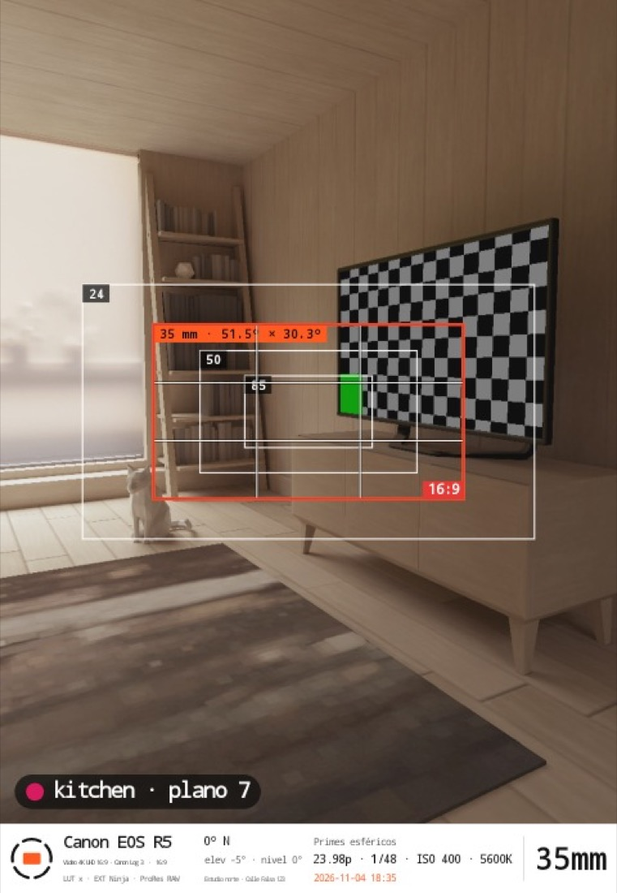

La **barra inferior** lleva: cámara y modo (con el perfil de color), el lente del teléfono o tu nota, el rumbo y la inclinación, el nombre de la locación (si hay un proyecto elegido) o las coordenadas, el juego de lentes o los ajustes del operador, la fecha y la hora, y la **focal en grande**. La **etiqueta de escena** («kitchen · plano 7») queda abajo a la izquierda de la imagen.

Si moviste el teléfono mientras sacaba la foto, un aviso te lo dice: la foto puede salir corrida.

Con el sol encendido, las dos imágenes llevan también el círculo del sol, su recorrido y las horas en que entra al encuadre (capítulo 8). Con la profundidad de campo activada llevan la apertura, la distancia de enfoque y el rango nítido; y si tocaste para enfocar, la marca del punto de enfoque (capítulo 7).

## 10. Proyectos, locaciones y escenas

Menú **☰ → proyectos y locaciones**.

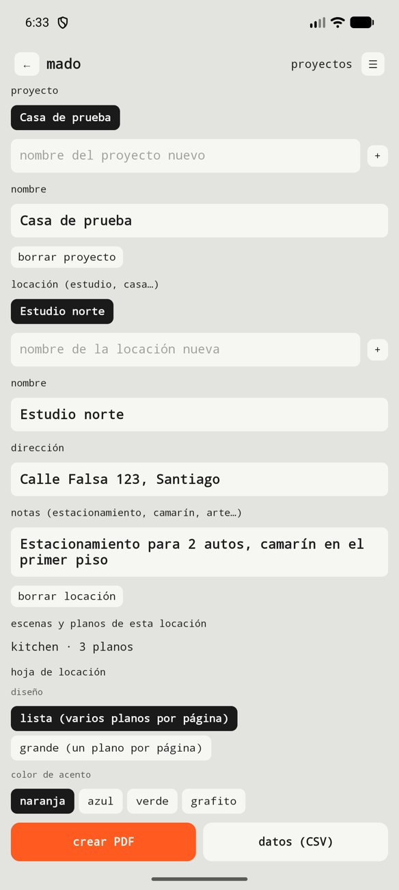

1. **Proyecto:** escribe el nombre y toca **+**.
2. **Locación** (un estudio, una casa…): escribe el nombre y toca **+**. Anota la **dirección** y las **notas de logística** (estacionamiento, camarín, arte…).
3. En el panel de opciones eliges el proyecto y la locación activos. Cada foto queda asociada a ellos.
4. La **escena** (por ejemplo «chimenea») y el **número de plano** se escriben en el panel. Después de cada foto, el número sube solo. Las escenas ya usadas en la locación aparecen como atajos y continúan su numeración.

5. **Ver y editar los planos:** en la misma pantalla, toca **ver y editar planos**. Verás cada plano con su miniatura, agrupados por escena. Tócalo para corregir la **escena**, el **número de plano** y los **ajustes del operador**, para **abrir la foto** o para **borrarlo**. La foto conserva la etiqueta con que se tomó; la hoja de locación y el CSV usan los datos corregidos. Al borrar, eliges entre quitarlo solo de la hoja (las fotos quedan en la galería) o borrar también sus fotos (no se puede deshacer).

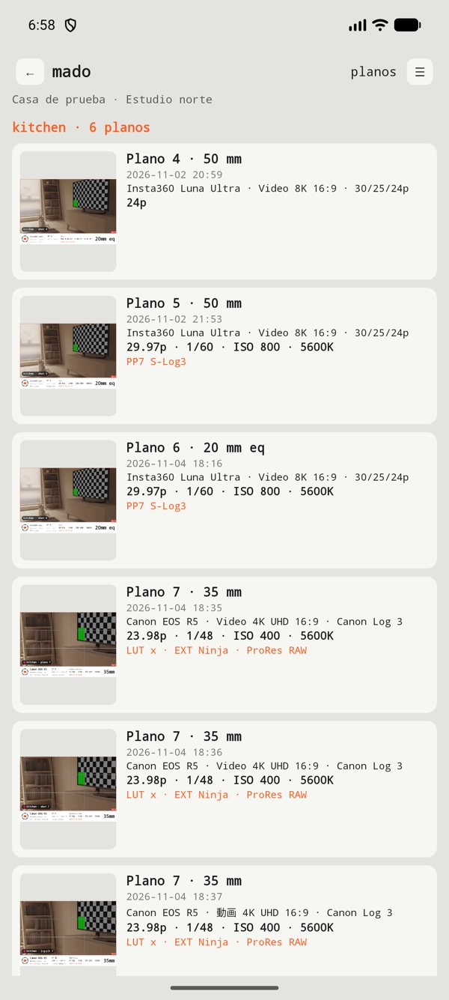 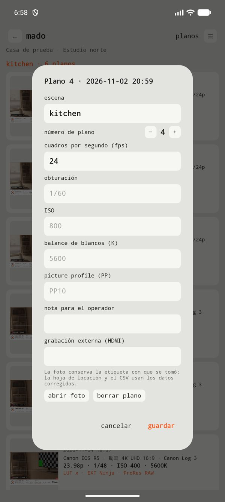

Borrar un proyecto o una locación solo los quita de la lista: **las fotos quedan en la galería.**

## 11. Hoja de locaciones (PDF y CSV)

En la pantalla de proyectos, debajo de las escenas, está la sección **hoja de locación**.

1. Elige el **diseño:** *lista* (varios planos por página) o *grande* (un plano por página, con la vista completa del encuadre).
2. Elige el **color de acento** (naranja, azul, verde o grafito).
3. Toca **crear PDF**. Se guarda en `Descargas/Mado` y se abre el menú para compartirlo.

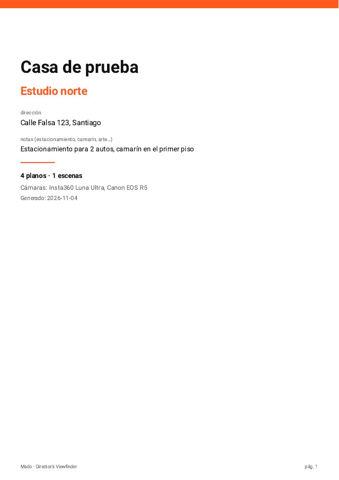 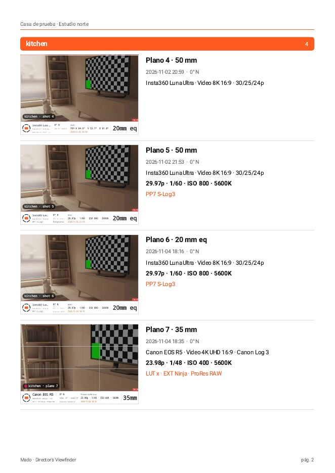 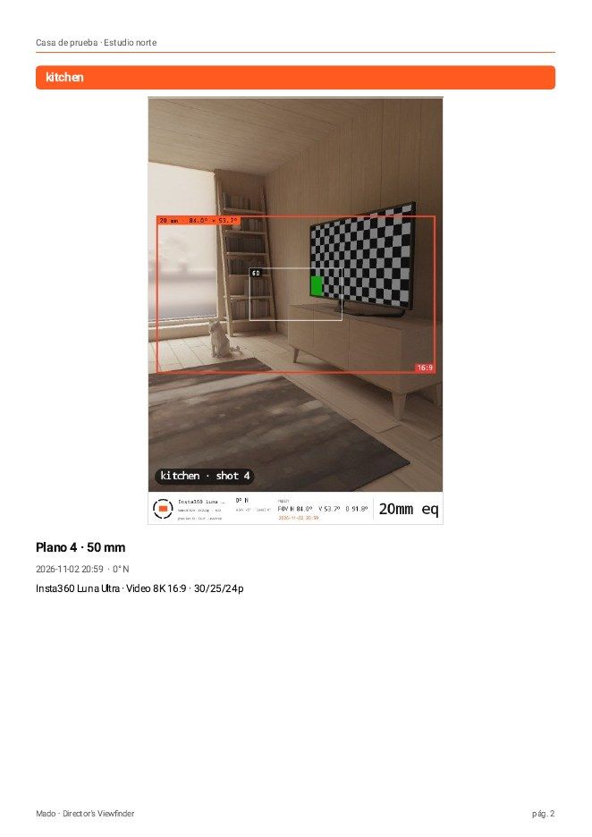

El PDF es A4 con fondo blanco. La portada lleva el proyecto, la locación, la dirección, las notas, los totales y las cámaras usadas. Los planos van agrupados por escena, con su foto, el número de plano, la focal, la hora, el rumbo, la cámara y el modo, los ajustes del operador y las notas. Incluye texto en japonés. Si una foto se borró de la galería, la hoja lo indica en su lugar.

**Datos (CSV):** una fila por plano, para quien prefiera armar el documento en Keynote, Canva o una planilla.

## 12. Calibración: por qué importa y cómo hacerla

El recuadro se calcula con el **campo de visión del lente del teléfono**. Cada teléfono informa ese dato con un margen de error de unos grados, mayor en los gran angulares. Cuando un lente está **calibrado** (medido), el recuadro es preciso. Cuando no, aparece el aviso y la foto lo anota como «sin verificar».

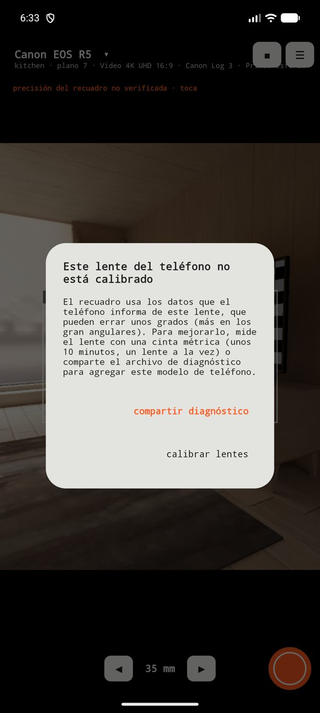

**Si tu teléfono no está calibrado, tienes dos opciones** desde el aviso:

- **Compartir diagnóstico:** manda el archivo técnico del teléfono (modelo, versión de Android y datos de sus cámaras, sin fotos ni ubicación) para que agreguemos tu modelo.
- **Calibrar lentes:** mides el lente tú mismo (unos 10 minutos por lente).

### Cómo medir un lente
Necesitas una **cinta métrica**, cinta adhesiva y una pared plana. Menú **☰ → calibrar lentes**.

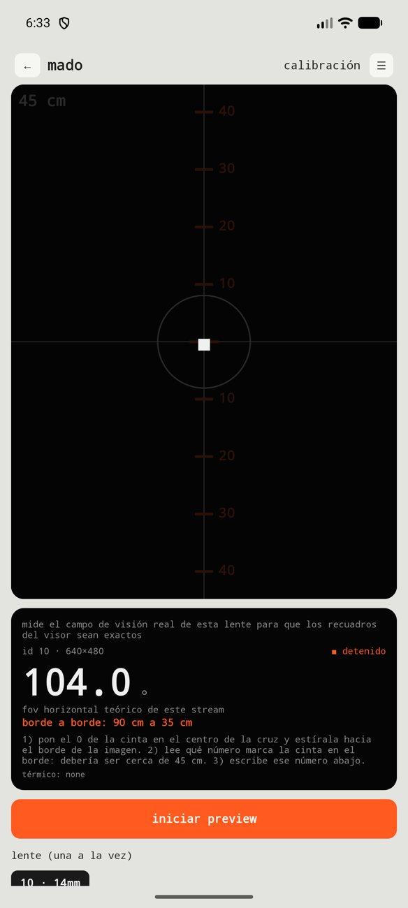

1. Elige el **lente**, uno a la vez. La app sugiere la **distancia** a la pared.
2. Pega la cinta en la pared en horizontal, a la altura del lente. Pon el teléfono (en horizontal) a esa distancia, **medida desde el vidrio del lente**, apuntando recto y apoyado en algo estable.
3. Toca **iniciar preview**. Pon el **0 de la cinta bajo la cruz** del centro y estírala hacia un borde de la imagen.
4. Lee **qué número de la cinta queda justo en el borde de la imagen** y escríbelo. Toca **guardar**.
5. Toca **detener** antes de cambiar de lente y repite con cada una.
6. Al terminar, toca **compartir** para enviar las mediciones.

> **Consejos.** Los números naranjas de la pantalla son una regla guía calculada con el valor teórico: el número que importa es el del borde. Un error de distancia pesa mucho en los gran angulares; mide dos veces. Los teleobjetivos pueden no enfocar de cerca: usa 1 m o más. Si el teléfono se calienta, detén.

La pantalla también muestra la **calibración interna** del teléfono (si la entrega), para que la compares con lo que lees en la cinta.

## 13. Calor, batería y privacidad

- **Para no calentar el teléfono,** el preview es liviano y tiene límites: se pausa tras **90 segundos sin tocar la pantalla**, se detiene a los **5 minutos** y se apaga si el teléfono se **calienta** (verás un aviso). Vuelves con **iniciar preview**.
- **La foto en resolución completa** solo se toma cuando tocas el obturador.
- **Privacidad:** sin anuncios, sin seguimiento y sin permiso de internet. Fotos, proyectos y ajustes quedan en tu teléfono. El archivo de diagnóstico solo se comparte si tú lo envías. La política completa está en `docs/politica-privacidad.md`.

## 14. Idioma y tema

Menú **☰ → idioma** (automático, español, English o 日本語) y **☰ → tema** (automático, claro, oscuro o **rojo** para sets a oscuras).

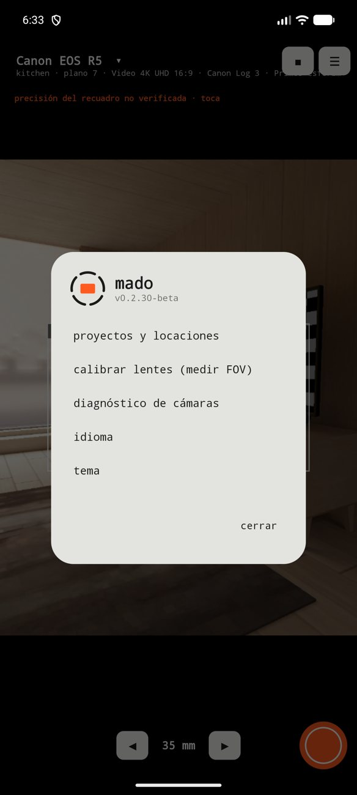

## 15. Solución de problemas

- **El recuadro no coincide con lo que veo.** Calibra el lente (capítulo 12). Sin calibrar, el error puede ser de unos grados.
- **El fondo sale desenfocado.** Toca en pantalla el sujeto que quieres enfocado y mira la distancia que aparece junto al marcador. El foco queda fijo hasta tu siguiente toque. Para volver al enfoque continuo, reinicia el preview.
- **El círculo del sol no cae sobre el sol real.** Es la brújula del teléfono, no el cálculo. Muévelo en forma de 8 y usa **◎** para ajustarla tocando el sol real (capítulo 8).
- **La foto dice «enfocado» pero se ve borrosa.** La profundidad de campo que muestra Mado es la de la cámara simulada, no la del teléfono. Además, el autofoco del teléfono puede dar por bueno un cielo o una pared sin detalle: toca un objeto con bordes definidos.
- **Aviso «el teléfono se movió».** Mantén el teléfono quieto hasta que aparezca «✓ guardada».
- **La cámara se apagó sola.** Fue por inactividad (90 s), por el límite de 5 minutos o por calor.
- **En el PDF una foto dice «foto no disponible».** La foto original ya no está en la galería.
- **Quiero un formato que no está.** Usa «personalizada» y escribe el sensor, y avísanos qué cámara y modo te faltan.

## 16. Glosario

- **FOV (campo de visión):** cuánto abarca un lente, en grados.
- **Aspecto de entrega:** la proporción final del video (por ejemplo 16:9).
- **Factor de compresión (squeeze):** cuánto comprime un lente anamórfico la imagen a lo ancho (2x, 1.33x).
- **Log:** curva de grabación plana para tener más margen al corregir color (S-Log3, Canon Log 3, I-Log…).
- **Picture Profile (PP):** ajuste de imagen que se guarda en las cámaras Sony.
- **Regla de 180°:** velocidad de obturación igual a la mitad del tiempo de cada cuadro (1/48 s a 24 fps).
- **Profundidad de campo:** la zona, delante y detrás del punto enfocado, que se ve nítida.
- **Hiperfocal:** la distancia de enfoque que deja nítido todo desde la mitad de esa distancia hasta el infinito.
- **Azimut y elevación:** la dirección del sol en la brújula (0° = norte) y su altura sobre el horizonte, en grados.
- **Hora dorada y hora azul:** los momentos de luz baja y cálida cerca del amanecer y el atardecer, y de luz azulada justo antes y después.
- **Equivalente full frame:** la focal que daría el mismo campo en un sensor de 36 mm de ancho.

## 17. Comentarios

Mado está en beta y tu experiencia mejora la app. Cuéntanos qué cámaras usas, qué datos necesitas ver y qué te falla. Escribe a quien te invitó a la beta. *(Correo de contacto: por definir antes del lanzamiento.)*
