# Mado · Director's Viewfinder
## ユーザーマニュアル

バージョン 0.2.32 ベータ · 2026年11月

※ この日本語版は翻訳の下書きで、日本語ネイティブによる確認はまだです（原文はスペイン語・英語版）。

---

## 1. Mado とは

Mado（窓）は、スマホのカメラを**ディレクターズビューファインダー**に変えるアプリです。カメラ、記録モード、レンズを選ぶと、ライブ映像の上に、そのカメラが捉える枠を描きます。機材を持たずにロケハンで構図を決め、本番のカメラで同じ画を再現するために必要な情報を記録できます。

Mado は動画を録画しません。**枠を示す写真**を撮り、技術データを付けます。

> **重要。** 枠は計算によるシミュレーションです。精度はスマホのレンズの校正に左右されます（第10章）。未校正のレンズはアプリが知らせます。

## 2. はじめる前に

- **端末：** Android 10 以上。
- **権限：** カメラ（必須）と位置情報（任意。場所と方位の記録用）。Mado には**インターネット権限がありません**。データは端末の外に出ません。
- **この版で校正済みの端末：** Samsung Galaxy S26 Ultra（メインと2つの望遠。超広角は測定待ち）と Sony Xperia 1 III（SO-51B、背面3レンズ）。それ以外の端末では、端末が報告する情報を使い、その旨を表示します。
- **ベータ版のインストール：** 招待した人から APK ファイルを受け取り、開いて「提供元不明のアプリ」を許可してください。以前の版の上にそのままインストールします。

## 3. 最初の一歩（5分）

1. Mado を開きます。**Canon EOS R5** から始まります。
2. **プレビュー開始**（中央のオレンジのボタン）をタップします。
3. 画像の上に枠が出ます。**オレンジ**が現在の焦点距離、**白**がキットのほかの焦点距離です。
4. 下の **◄ ►** で焦点距離を切り替えます。
5. **シャッター**（オレンジの円）をタップします。写真は `Pictures/Mado` に保存されます。

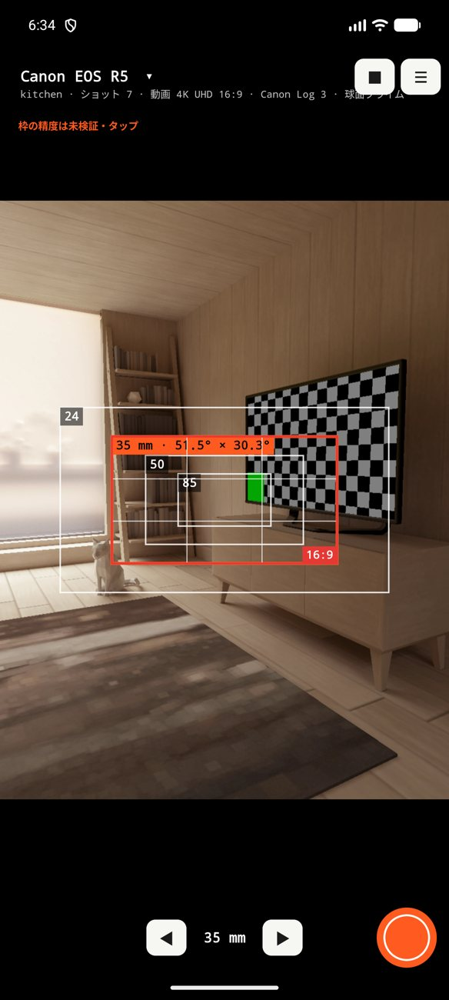

## 4. ビューファインダー画面

- **左上はカメラ。** カメラ名、その下にシーンとショット番号、記録モード、カラープロファイル、レンズセットを表示します。**タップすると設定パネルが開きます。**
- **右上：** **■** でプレビュー停止、**☰** でメニュー。
- **枠：** キットの焦点距離ごとに1つ。オレンジが現在のものです。シミュレートするカメラの画角がスマホより**広い**と、枠がファインダーいっぱいになり、スマホの画像が小さくなります。
- **下：** ◄ 焦点距離 ► と**シャッター**。横向きでは操作キーが横に移ります。
- **画像をタップ**すると、その位置でピントと露出を合わせます。ピントが合った距離（例：「1.33 m」）がマーカーの横に出ます。次にタップするまでピントは固定されます。
- **ダブルタップ：** 現在の枠で**実際に写る範囲**を表示する切り抜き表示。オレンジの表示をタップすると戻ります。
- **「枠の精度は未検証・タップ」**はスマホのレンズが未校正のときに出ます（第10章）。

## 5. カメラ・モード・レンズの選択（設定パネル）

左上のカメラ名をタップします。パネルは上下にスクロールできます。

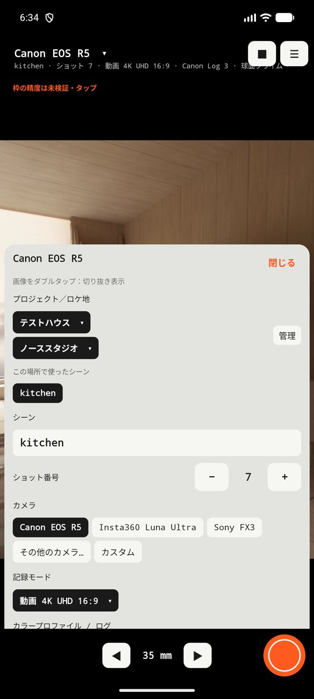 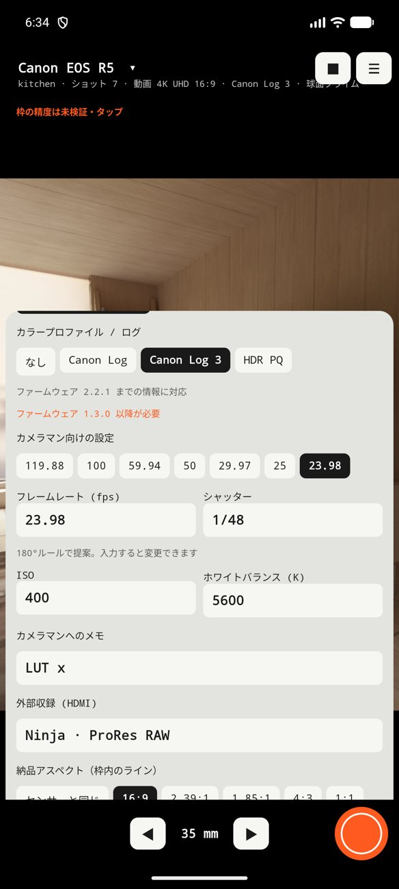

### 5.1 カメラ
主なカメラ（**Canon EOS R5**、**Insta360 Luna Ultra**、**Sony FX3**）はすぐ選べます。ほかは**その他のカメラ…**にあります。**カスタム**ではセンサーの幅と高さ（mm）を入力します。

### 5.2 記録モード
画角はカメラだけでなく、**各モードが使うセンサー領域**で決まります。4K をセンサー全幅で記録するのと、クロップで記録するのとは別です。各カメラのモードには公式の出典が付いています。メーカーが正確な領域を公表していない場合は**推定値**と表示します。情報は把握している最新のファームウェアに合わせてあり、パネルに「ファームウェア 2.2.1 までの情報に対応」のように表示します。最低限のファームウェアが必要な形式は、その旨を知らせます。

### 5.3 カラープロファイル／ログと Picture Profile
記録するプロファイル（Canon Log、Canon Log 3、S-Log3、I-Log、HDR PQ など）を選びます。モードの横、ファインダー、写真のバーに表示されます。**Sony FX3** では **Picture Profile**（PP1〜PP6、PP10、PP11）も選べます。各 PP の中身はカメラ操作者が設定するので、メモに書いてください（第6章）。

### 5.4 レンズセットと焦点距離キット
- **レンズセット：** リストから選びます。汎用のもの（球面、アナモルフィック 2x・1.33x）と、**実在の名前**のセット（**DZOFilm Arles**、**Zeiss CP.3**、**Cooke S4/i**、**Atlas Orion 2x**）があり、それぞれ焦点距離の出典が付いています。アナモルフィックでは圧縮率に応じて枠が横に広がります。
- **自分のセット：** **新しいレンズセット**で、名前、カンマ区切りの焦点距離、アナモルフィックなら圧縮率を入力します。リストの末尾に ★ 付きで並び、**このセットを編集**で修正・削除できます。
- セットを選ぶと、描画するキットは 24、35、50、85 mm に最も近い焦点距離になります。実名セットの焦点距離リストは、メーカーではなく販売店やメディアの情報によるものが多いので、お手持ちのセットと違う場合は自分のセットを作成してください。

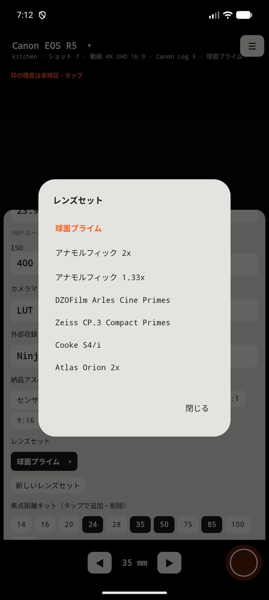 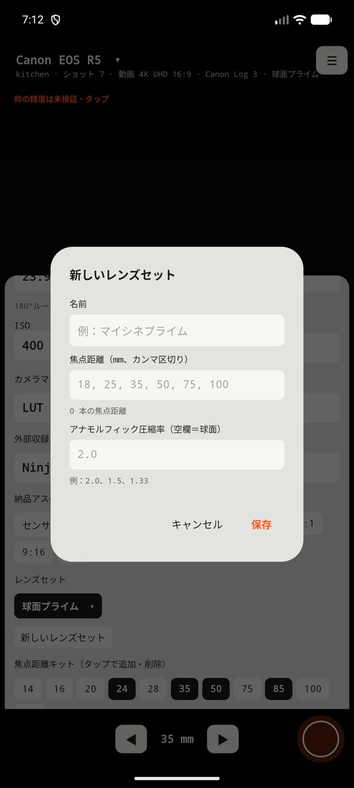
- **焦点距離キット：** 数字をタップして追加・削除します。すべて同時に描かれます。
- **焦点距離 (mm)：** 現在の焦点距離。レンズ固定のカメラ（Luna Ultra など）では内蔵レンズを選び、焦点距離は換算値です。

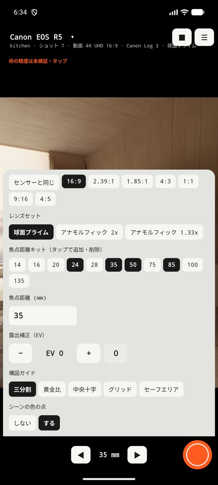 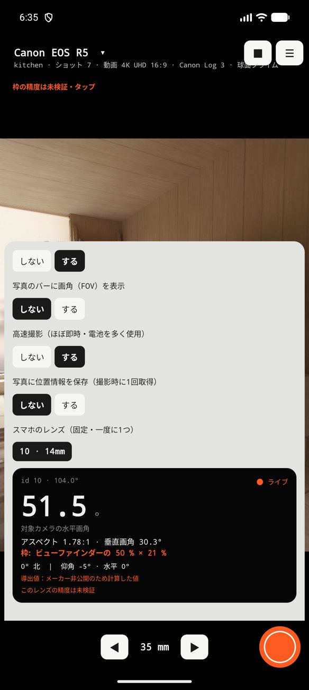

### 5.5 納品アスペクト
センサー上に、最終納品の比率（16:9、2.39:1、1.85:1、4:3、1:1、9:16、4:5）の**赤いライン**を描きます。例：3:2 のセンサー上の 16:9。

### 5.6 露出・ガイド・その他
- **露出補正（EV）：** スマホの露出を補正します。プレビューと写真に効きます。
- **構図ガイド：** 三分割、黄金比、中央十字、グリッド、セーフエリア。
- **シーンの色の点：** 写真のタグにシーンごとの色の点を付けます（オフにできます）。
- **写真のバーに画角（FOV）を表示：** 初期設定はオフ。
- **高速撮影：** ほぼ即座に撮れます（電池を多く使います）。
- **写真に位置情報を保存：** 撮影時に GPS を1回読み取ります。
- **スマホのレンズ：** 基準にするスマホのレンズ。Mado は校正済みのレンズから始めます。

## 6. カメラマン向けの設定

ロケハンをする人と、カメラを操作する人は同じとは限りません。この項目に、操作者に必要な情報を記録します。

- **フレームレート (fps)：** モードが提供する値から選ぶか、入力します。
- **シャッター：** **180°ルール**で自動提案します（24 fps で 1/48、30 fps で 1/60、25 fps で 1/50）。ほかの値を入力すれば、その値が残ります。
- **ISO** と **ホワイトバランス (K)。**
- **Picture Profile**（FX3）。
- **カメラマンへのメモ：** LUT や ND フィルターなど。
- **外部収録 (HDMI)：** レコーダーと形式。例：「Ninja · ProRes RAW」。

すべて写真のバーに表示され、データにも別々に保存されます。

## 7. 写真：Mado が保存するもの

シャッターを押すたびに、`Pictures/Mado` に**2枚**保存されます。

- **`_marco`：** キット全体の枠、ガイド、納品ラインを重ねた写真。
- **`_plano`：** 現在の枠でそのまま切り抜いた、実際に写る範囲の写真。

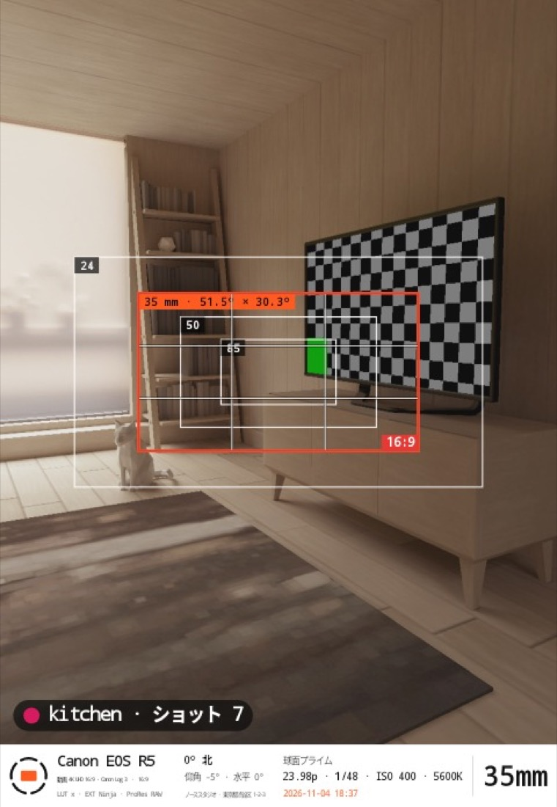

**下のバー**には、カメラとモード（カラープロファイル付き）、スマホのレンズまたはメモ、方位と傾き、ロケ地名（プロジェクト選択時）または座標、レンズセットまたは操作者の設定、日時、そして**大きな焦点距離**を表示します。**シーンタグ**（「kitchen · ショット 7」）は画像の左下にあります。

撮影中にスマホを動かすと、お知らせが出ます。写真がずれている可能性があります。

## 8. プロジェクト、ロケ地、シーン

メニュー **☰ → プロジェクトとロケ地**。

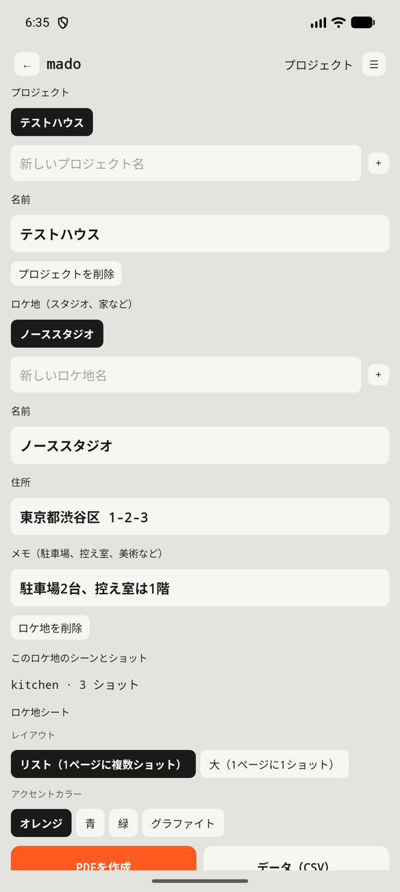

1. **プロジェクト：** 名前を入力して **+** をタップします。
2. **ロケ地**（スタジオ、家など）：名前を入力して **+** をタップします。**住所**と**運用メモ**（駐車場、控え室、美術など）を書きます。
3. 設定パネルで、使用中のプロジェクトとロケ地を選びます。写真はそれらに紐づきます。
4. **シーン**（例：「暖炉」）と**ショット番号**はパネルで入力します。撮影のたびに番号は自動で上がります。そのロケ地で使ったシーンはショートカットとして出て、番号を引き継ぎます。

5. **ショットを見る・編集：** 同じ画面で**ショットを見る・編集**をタップします。ショットがシーンごとに、サムネイル付きで並びます。タップすると、**シーン**、**ショット番号**、**操作者の設定**を修正したり、**写真を開いたり**、**削除**したりできます。写真には撮影時のラベルが残り、ロケ地シートと CSV は修正後のデータを使います。削除では、シートからだけ外す（写真はギャラリーに残る）か、写真も削除する（元に戻せません）かを選べます。

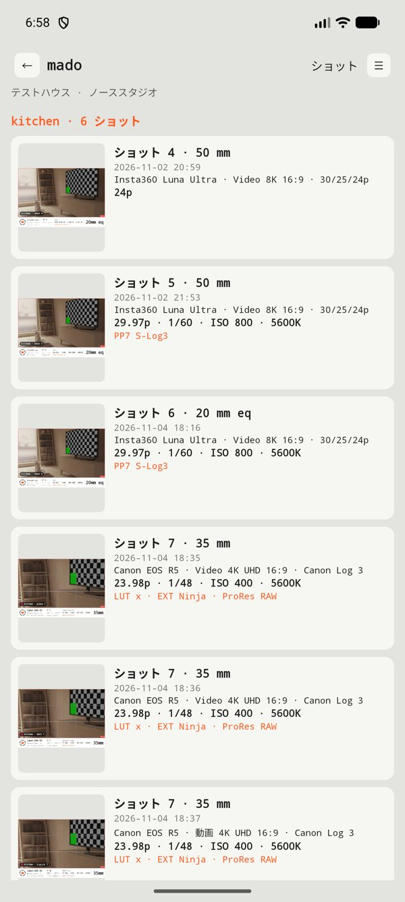 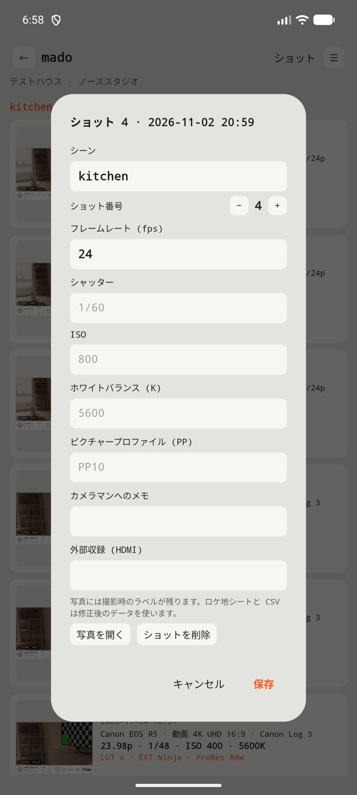

プロジェクトやロケ地の削除は一覧から消すだけです。**写真はギャラリーに残ります。**

## 9. ロケ地シート（PDF と CSV）

プロジェクト画面のシーン一覧の下に、**ロケ地シート**があります。

1. **レイアウト**を選びます：*リスト*（1ページに複数ショット）または*大*（1ページに1ショット、枠の全体表示付き）。
2. **アクセントカラー**を選びます（オレンジ、青、緑、グラファイト）。
3. **PDFを作成**をタップします。`Download/Mado` に保存され、共有メニューが開きます。

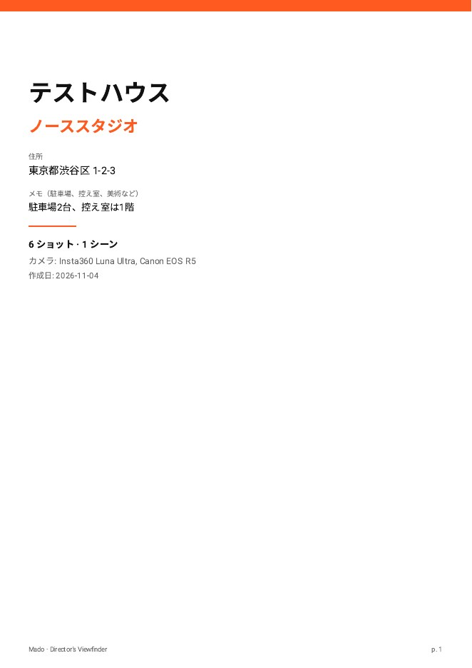 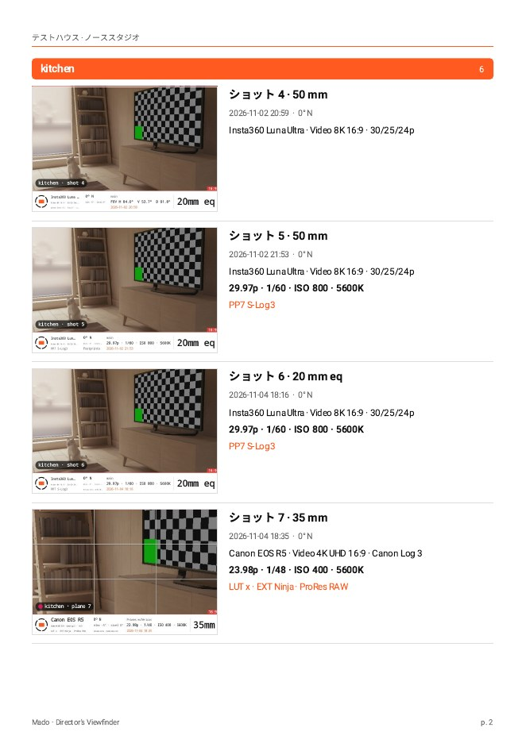 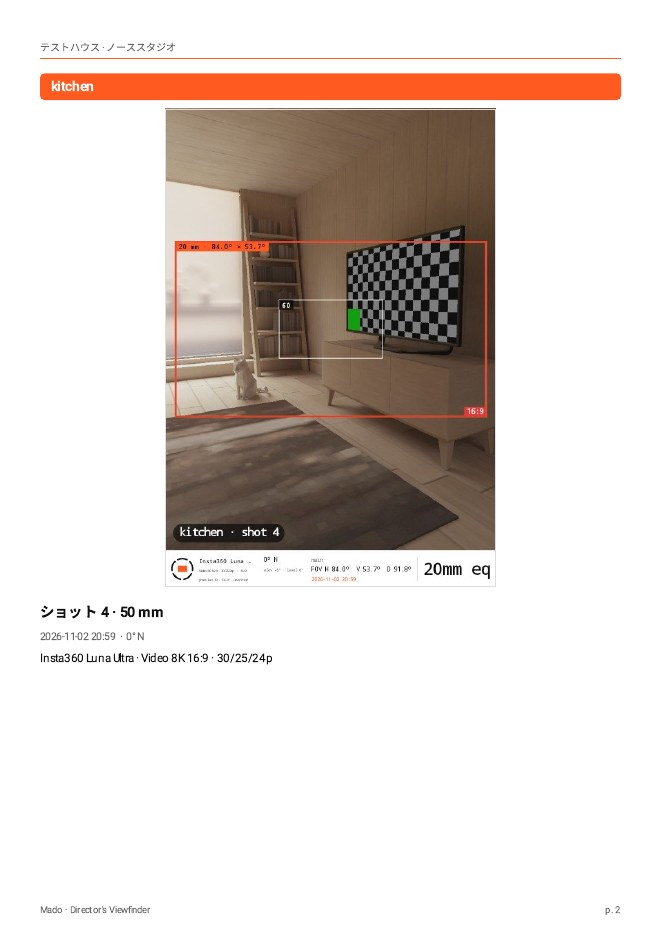

PDF は白地の A4 です。表紙には、プロジェクト、ロケ地、住所、メモ、合計、使用カメラが入ります。ショットはシーンごとにまとまり、写真、ショット番号、焦点距離、時刻、方位、カメラとモード、操作者の設定、メモが付きます。日本語の文字も入ります。ギャラリーから写真が消えていた場合は、その位置に表示します。

**データ（CSV）：** 1ショット1行。Keynote、Canva、表計算で資料を作りたい人向けです。

## 10. 校正：なぜ必要で、どうやるか

枠は、**スマホのレンズの画角**から計算します。端末が報告する値には数度の誤差があり、広角レンズほど大きくなります。レンズが**校正済み**（実測済み）なら枠は正確です。未校正のときはお知らせが出て、写真にも「未検証」と記録されます。

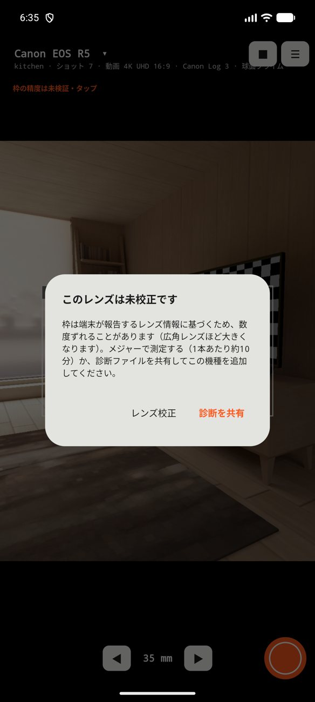

**端末が未校正なら、お知らせから2つの方法があります。**

- **診断を共有：** 端末の技術ファイル（機種、Android のバージョン、カメラのデータ。写真や位置情報は含みません）を送り、機種を追加してもらいます。
- **レンズ校正：** 自分でレンズを測定します（1本あたり約10分）。

### レンズの測り方
**メジャー**、テープ、平らな壁を用意します。メニュー **☰ → レンズ校正（画角の測定）**。

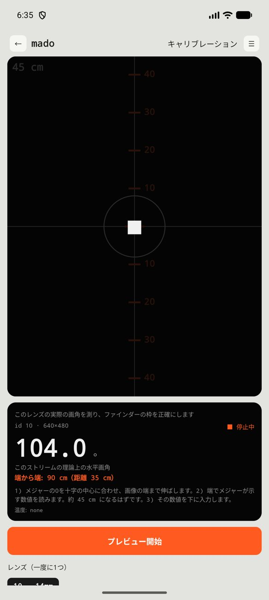

1. **レンズ**を1つ選びます。アプリが壁までの**距離**を提案します。
2. 壁にメジャーをレンズの高さに合わせて水平に貼ります。スマホ（横向き）をその距離に置きます。距離は**レンズのガラス面から**測り、壁にまっすぐ向けて安定した場所に固定します。
3. **プレビュー開始**をタップします。メジャーの**0を中央の十字に**合わせ、画像の端のほうへ伸ばします。
4. **画像の端にちょうど来ているメジャーの数値**を読み、入力して**保存**をタップします。
5. レンズを替える前に**停止**を押し、各レンズで繰り返します。
6. 終わったら**共有**をタップして測定値を送ります。

> **ヒント。** 画面のオレンジの数字は理論値で計算したガイドの目盛りです。大事なのは端の数値です。広角レンズでは距離の誤差が大きく効くので、2回測ってください。望遠は近くでピントが合わないことがあります。1 m 以上で測定します。本体が熱くなったら停止します。

この画面には、端末の**内部キャリブレーション**（提供されている場合）も表示されます。メジャーの読みと比べられます。

## 11. 発熱、電池、プライバシー

- **端末を熱くしないために、**プレビューは軽く、制限があります。**90秒間操作がない**と一時停止し、**5分**で停止し、端末が**熱く**なると切れます（お知らせが出ます）。**プレビュー開始**で再開します。
- **フル解像度の写真**はシャッターを押したときだけ撮ります。
- **プライバシー：** 広告なし、トラッキングなし、インターネット権限なし。写真、プロジェクト、設定は端末内に残ります。診断ファイルは自分で送ったときだけ共有されます。ポリシーの全文は `docs/politica-privacidad.md` にあります。

## 12. 言語とテーマ

メニュー **☰ → 言語**（自動、español、English、日本語）と **☰ → テーマ**（自動、ライト、ダーク、暗いセット用の**赤**）。

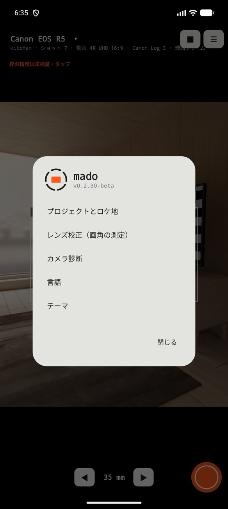

## 13. トラブルシューティング

- **枠が見えているものと合わない。** レンズを校正してください（第10章）。未校正だと数度の誤差が出ることがあります。
- **背景がぼける。** ピントを合わせたい被写体を画面でタップし、マーカーの横に出る距離を確認します。次にタップするまでピントは固定されます。連続ピントに戻すにはプレビューを再開します。
- **「スマホが動いた」の表示。** 「✓ 保存」が出るまで動かさないでください。
- **カメラが勝手に切れた。** 操作なし（90秒）、5分の上限、または発熱が原因です。
- **PDF に「写真がありません」と出る。** 元の写真がギャラリーから消えています。
- **必要な形式がない。** 「カスタム」でセンサーを入力し、足りないカメラとモードを教えてください。

## 14. 用語集

- **FOV（画角）：** レンズが写す範囲（度）。
- **納品アスペクト：** 動画の最終的な比率（例：16:9）。
- **圧縮率（スクイーズ）：** アナモルフィックレンズが画像を横方向に圧縮する比率（2x、1.33x）。
- **ログ：** 色調整の余裕を残すフラットな記録カーブ（S-Log3、Canon Log 3、I-Log など）。
- **Picture Profile (PP)：** Sony のカメラに保存する画づくりの設定。
- **180°ルール：** シャッター速度を1コマの時間の半分にする（24 fps で 1/48 秒）。
- **フルサイズ換算：** 幅 36 mm のセンサーで同じ画角になる焦点距離。

## 15. フィードバック

Mado はベータ版で、皆さんの使い方がアプリを良くします。使っているカメラ、見たいデータ、うまくいかない点を教えてください。ベータに招待した人に連絡してください。*（連絡先メール：公開前に決めます。）*
